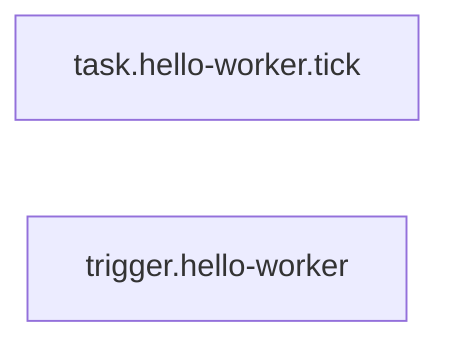

<p align="center">
  
</p>

<h1 align="center">Loutre</h1>

<p align="center">
  <strong>TypeScript Application Framework</strong><br>
  One application. Any runtime. Visible architecture.
</p>

<p align="center">
  Compose HTTP, Tasks, Triggers, Queues, and more into an explicit Application Graph, with a shared application model for runtimes and developer tooling.
</p>

<p align="center">
  <a href="https://loutrejs.come25136.id">Website</a> ·
  <a href="./docs/getting-started.md">Getting Started</a> ·
  <a href="./examples/">Examples</a>
</p>

<p align="center">
  <a href="https://github.com/come25136/loutrejs/actions/workflows/ci.yml"></a>
  <a href="https://www.npmjs.com/package/@loutrejs/loutre"></a>
  <a href="./LICENSE"></a>
</p>

## Application Graph

Loutre separates the Application Definition from runtime-specific startup code and compiles it into an Application Graph. HTTP endpoints and background executions belong to the same graph, so runtimes, `loutre check`, `loutre graph`, OpenAPI generation, and builds all use the same configuration.

For example, register HTTP executions and scheduled Tasks in the same application model:

```ts
const WorkerModule = defineModule({
  executions: [cleanup, heartbeat],
})

export default defineApplication({
  modules: [ApiModule, WorkerModule],
})
```

Inspect the graph directly from the CLI:

```sh
npm exec loutre -- graph executions --entry src/app.ts --format mermaid
```

The following diagram shows the Mermaid output from `loutre graph` for this configuration:



The Application Graph is more than just a visualization. It validates Modules, dependencies, Contracts, executions, and runtime capabilities, serving as a shared model for developer tooling and runtimes.

## Quick Start

```sh
npm create loutre@latest my-app
cd my-app
npm run dev
```

You can also create a project with Bun:

```sh
bun create loutre my-app
```

Choose a starter for Node.js, Bun, Cloudflare Workers, or AWS Lambda.

## Why Loutre

As applications grow, the boundaries between HTTP, background tasks, queues, configuration, DI, and deployment become more complex. Loutre brings them together through a single Application Definition and Application Graph.

Defining the configuration explicitly in TypeScript lets runtimes and developer tooling share the same application model. Loutre favors designs you can trace through types and structure over framework magic.

## Runtime Support

Application code stays separate from runtime-specific APIs and connects to the execution environment through a Host / Runtime Adapter.

- Node.js
- Bun
- Cloudflare Workers
- AWS Lambda
- Electron

See [Getting Started](./docs/getting-started.md) and [Architecture](./docs/architecture.md) for each runtime's role and supported capabilities.

## Features

- **Application Graph** — Validate Modules, dependencies, Contracts, executions, and runtime capabilities as a single graph
- **Unified execution model** — Represent HTTP, Tasks, Triggers, and Queues in the same application model
- **Portable Application** — Separate the Application Definition from runtime-specific adapters
- **Type-safe composition** — Connect Contracts, DI, Pipelines, Environment, and Arguments in TypeScript
- **Explicit architecture** — Trace the configuration through code without relying on decorators or filesystem discovery
- **Developer Tooling** — Validate applications, visualize graphs, and generate OpenAPI documents and deployment artifacts

## Examples

Runnable projects are available in [`examples/`](./examples/).

- [`hello-http`](./examples/hello-http/) — An HTTP application using Contracts, Implementations, and DI
- [`hello-cli`](./examples/hello-cli/) — An application that accepts Arguments and runs a Task
- [`hello-worker`](./examples/hello-worker/) — A worker that runs a Task periodically with a `fixedDelay` Trigger
- [`graphql-orders`](./examples/graphql-orders/) — An orders server comparing Eager / Lazy / Hybrid strategies with a generated Manifest and Typed Field Builder
- [`graphql-counter`](./examples/graphql-counter/) — A GraphQL server providing Query, Mutation, and Subscription operations over state shared through DI
- [`basic-auth`](./examples/basic-auth/) / [`bearer-auth`](./examples/bearer-auth/) — HTTP authentication
- [`database-postgres`](./examples/database-postgres/) / [`database-drizzle-postgres`](./examples/database-drizzle-postgres/) / [`database-prisma-postgres`](./examples/database-prisma-postgres/) — Database integration

## Documentation

- [Website](https://loutrejs.come25136.id)
- [Getting Started](./docs/getting-started.md) — Project creation, HTTP, Tasks, runtimes, and the CLI
- [GraphQL Type Generation](./docs/graphql-codegen.md) — Shared SDL, typed resolvers, domain mapping, and client operations
- [Architecture](./docs/architecture.md) — Boundaries between the Application Definition, Application Graph, and runtimes
- [Examples](./examples/) — HTTP, GraphQL, authentication, CORS, workers, and databases

## Packages

| Package                                                              | Role                                            |
| -------------------------------------------------------------------- | ----------------------------------------------- |
| [`@loutrejs/loutre`](https://www.npmjs.com/package/@loutrejs/loutre) | Kernel / HTTP / Tasks / MessagePort / WebSocket |
| [`@loutrejs/node`](https://www.npmjs.com/package/@loutrejs/node)     | Node.js HTTP Runtime Adapter                    |
| [`@loutrejs/bullmq`](https://www.npmjs.com/package/@loutrejs/bullmq) | BullMQ Queue Driver                             |
| [`@loutrejs/cli`](https://www.npmjs.com/package/@loutrejs/cli)       | Graph / build / OpenAPI tooling                 |
| [`create-loutre`](https://www.npmjs.com/package/create-loutre)       | Project initializer                             |

Tasks, MessagePort, and WebSocket are available as subpath imports from `@loutrejs/loutre/tasks`, `@loutrejs/loutre/message-port`, and `@loutrejs/loutre/websocket`, respectively, rather than as separate packages.

## Project Status

> [!WARNING]
> Loutre is currently in the v0.x series. Breaking changes to the public API may occur.

The public API is evolving with a focus on design consistency. For production use, pin your version and review the release notes.

## Contributing

```sh
npm install
npm run verify
```

Tests are organized into three layers by responsibility:

- `npm run test:unit` — Test individual framework components
- `npm run test:integration` — Test boundaries using applications and Modules in `integrations/`
- `npm run test:e2e` — Run actual commands in `examples/` and test complete projects through their external interfaces

`integrations/` contains test fixtures, while `examples/` contains runnable projects for users.

## License

[MIT](./LICENSE)
