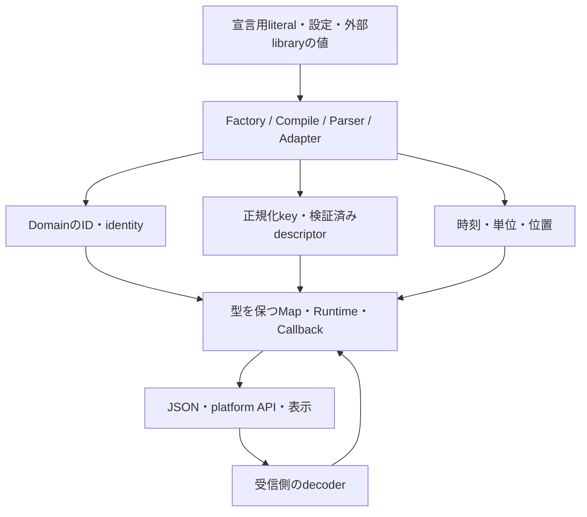

# Loutre全体へのBranded Types導入

- 状態: 採用
- 日付: 2026-10-26
- 対象: 全packageの実行・生成処理、CLI、WebsiteのDevTools
- 詳細: [CoreのModel ID](loutre_core_branded_ids.md)、[DevToolsのID](loutre_devtools_branded_ids.md)
- 関連する既存契約: [Execution Extension Contract](loutre_execution_extension_contract_architecture.md)

## 方針

意味の異なる値が同じprimitiveとして渡される箇所に、Branded Typesを全面的に使用する。対象はIDだけでなく、symbol identity、正規化・検証を経た値、合成key、時間・サイズ・位置の単位、factoryで生成する正規のdescriptorまでとする。

宣言用のobject literalや外部APIの型まで一律に置き換えると、入力するたびに変換が必要になる。宣言・外部入力を受ける入口では通常の型を受け取り、factory、compile、parser、adapterが意味を確定する。確定後の内部処理、Map、Set、callback、出力型までbrandを保持する。

段階的に実装しても、採用範囲からWebsiteや他のExtensionを外さない。完了条件は、以下の採用対象すべてで生成から利用まで型が通ることである。

## 精査で分かった修正点

- `RuntimeExecutionMetadata.executionId`はModel由来でない値も受け取るが、brand化を諦める必要はない。`ExecutionNodeId | SyntheticExecutionId`に分ける。
- CoreのGraph IRとCLIのGraph viewは異なる。CLIはentrypoint、middleware、handlerを追加し、Websiteはmodule group、描画edge、handleも追加する。これらをすべてCoreの`ModelNodeId`と呼ばない。
- `RuntimeCapability.identity`と`ExecutionExtension.identity`はともにsymbolだが別のRegistryのkeyである。さらにTasksのtask identityも別である。
- `runtime/capability.ts`の既存`RuntimeCapabilityId = string`は`http.fetch`などの実行環境のsupport featureを表す。Coreの`http.server`などのdriver capability IDと同じ型にしない。
- CORSの`maxAge`は秒、shutdownやTTLはミリ秒。`timestamp`はepoch時刻、`performance.now()`はprocess内の時刻である。
- SWCのspanは1起算のUTF-8バイト位置、JS文字列への挿入位置は0起算のUTF-16 indexである。`Map<number, number>`のままでは変換の向きを型で検査できない。

## 採用範囲

表の型名は設計上の名称である。公開する型は利用者が直接受け取るものに絞り、内部の合成keyや位置型は内部に閉じる。関係する値は既存の生成・変換箇所を正本にする。

### Core・Graph・Runtime

| 対象・所有者                             | 採用する型と境界                                                                                          | 防げる取り違え・根拠                                                                                                                                                                                                                     |
| ---------------------------------------- | --------------------------------------------------------------------------------------------------------- | ---------------------------------------------------------------------------------------------------------------------------------------------------------------------------------------------------------------------------------------- |
| Model builder                            | `ModuleId`、`ProviderNodeId`、`ExecutionNodeId`、`LifecycleNodeId`、`CapabilityNodeId`、`ExtensionNodeId` | Nodeの種類、所有Module、edge端点。[Model型](../../packages/loutre/src/core/model/types.ts)、[builder context](../../packages/loutre/src/core/model/context.ts)                                                                           |
| CoreのCapability factory / Registry      | `CapabilityId`、`CapabilityIdentity`                                                                      | 表示・論理IDとsymbol lookup、Extension identityとの混同。[extension.ts](../../packages/loutre/src/core/extension.ts)                                                                                                                     |
| CoreのExtension factory / Model / Kernel | `ExtensionName`、`ExtensionAbiVersion`、`ExtensionIdentity`                                               | nameとABIの引数、CapabilityのRegistry keyとの混同。同じ名前・ABIによる`Symbol.for`の値は維持する。[extension.ts](../../packages/loutre/src/core/extension.ts)、[Kernel](../../packages/loutre/src/runtime/kernel.ts)                     |
| Module名・Host namespaceの登録           | 内部の`ModuleName`、`HostNamespace`                                                                       | Moduleの重複名とHost namespaceの登録keyの混同。公開APIを生成するnamespaceのliteral型は保持する。[Module宣言の収集](../../packages/loutre/src/core/model/modules.ts)、[namespace検証](../../packages/loutre/src/core/model/validation.ts) |
| instrumentation                          | `SyntheticExecutionId`と`ExecutionNodeId`のunion、`DependencyConsumerId`                                  | 実際のModel nodeと診断用・合成の識別子の混同。[instrumentation.ts](../../packages/loutre/src/core/instrumentation.ts)、[injection.ts](../../packages/loutre/src/core/injection.ts)                                                       |
| Runtime support profile                  | `RuntimeSupportFeature`                                                                                   | 実行環境のfeature名とCore driver capability IDとの混同。[capability.ts](../../packages/loutre/src/runtime/capability.ts)                                                                                                                 |
| error正規化                              | `ApplicationErrorId`                                                                                      | Errorの照合IDとTrace / request IDの混同。[error.ts](../../packages/loutre/src/runtime/error.ts)                                                                                                                                          |
| ModelからGraph / Runtimeへの参照         | ModelのID型を引き継ぐ                                                                                     | projection、Extension binding、Module単位の初期化とcleanupでの型消失。[Graph projection](../../packages/loutre/src/graph/model.ts)、[Kernel](../../packages/loutre/src/runtime/kernel.ts)                                                |
| source metadata                          | `SourceFileReference`、`SourceLine`、`SourceColumn`                                                       | sourceを示すfile表記とfilesystem操作用path、行と列の混同。[source-location.ts](../../packages/loutre/src/core/source-location.ts)                                                                                                        |

Capabilityの文字列ID、symbol identity、Modelに投影したNode IDは、三つの別の識別対象である。名前が対応していても一つのbrandにまとめない。Tokenの`key`は`TokenKey`としてToken factoryで型付けできるが、DIのlookup自体はToken object / classをキーにする現行方式を維持する。

### HTTP・WebSocket・MessagePort

| 対象・所有者                      | 採用する型と境界                                                                                                         | 防げる取り違え・根拠                                                                                                                                                                                            |
| --------------------------------- | ------------------------------------------------------------------------------------------------------------------------ | --------------------------------------------------------------------------------------------------------------------------------------------------------------------------------------------------------------- |
| HTTP path parser / compile        | `HttpPathTemplate`、`ParsedHttpPath`、`HttpNormalizedPath`、`RequestPathname`                                            | 宣言の`/users/{id}`、重複判定の`/users/{}`、実request pathの混同。`ParsedHttpPath`は検証済みsegment配列を表す。[path.ts](../../packages/loutre/src/http/path.ts)                                                |
| HTTP compile / routing            | `HttpMethod`、`HttpDispatchKey`、`HttpProcedureName`                                                                     | method、route名、path、dispatch keyの混同。wildcardは明示したunionで扱う。[route validation](../../packages/loutre/src/http/route-validation.ts)、[HTTP Extension](../../packages/loutre/src/http/extension.ts) |
| HTTP request decode               | `ContentTypeValue`、`NormalizedMediaType`                                                                                | header全体とmedia typeの混同。`validatedContentType`から`decodeBody`へ保証を渡す。[request.ts](../../packages/loutre/src/http/runtime/request.ts)                                                               |
| HTTP response compile             | `HttpResponseStatus`、検証済みresponse descriptor                                                                        | statusの範囲・bodyless規則の検証を迂回した内部descriptor。[HTTP Extension](../../packages/loutre/src/http/extension.ts)                                                                                         |
| CORS policy normalize             | `CorsOriginValue`、`HttpHeaderName`、`DurationSeconds`                                                                   | Originの完全一致key、methodとheader名、秒とミリ秒の混同。[cors-internal.ts](../../packages/loutre/src/http/cors-internal.ts)                                                                                    |
| Authentication header decode      | `BearerCredential`、decode済みの`BasicAuthCredentials`                                                                   | Authorization header全体と抽出後のcredentialの混同。認証成功を表す型にはしない。[auth.ts](../../packages/loutre/src/http/auth.ts)                                                                               |
| OpenAPI materialization           | `OpenApiOperationId`、`OpenApiSchemaName`、`JsonSchemaReference`、内部のschema比較key                                    | procedure名、schema名、`$ref`、重複判定keyの混同。[openapi.ts](../../packages/loutre/src/http/openapi.ts)                                                                                                       |
| HTTP client URL組み立て           | `HttpBaseUrl`、`RequestPathname`                                                                                         | base URLとpathの混同。[client.ts](../../packages/loutre/src/http/client.ts)                                                                                                                                     |
| WebSocket session / route compile | `WebSocketSessionId`、`WebSocketProcedureName`、`NegotiatedSubprotocol`、`ObservedCloseCode`。pathの型はHTTPのものを共有 | session IDとoperation IDの混同。重複判定は`HttpNormalizedPath`を使う。driverから受け取る値と送信要求を区別する。[WebSocket Extension](../../packages/loutre/src/websocket/extension.ts)                         |
| MessagePort receive / dispatch    | `MessagePortRequestId`、`MessagePortProcedureName`                                                                       | envelopeの相関IDと呼び出し先の混同。[transport.ts](../../packages/loutre/src/message-port/transport.ts)、[Extension](../../packages/loutre/src/message-port/extension.ts)                                       |

HTTP contractのpathは`PathParamNames<TPath>`などの推論に使われる。宣言のliteral型は保持し、compiled側でpathをbrand化する。`TPath`を単なる`HttpPathTemplate`へ広げない。routeやresponseのキーも、利用者向けの`keyof TContract`による対応を維持し、内部の汎用dispatchへ移すときに種類を確定する。

`HttpResponseStatus`の制約は現在のcontractの200–599を表す。platformの`Response.status`全般やWebSocket close codeへ流用しない。WebSocket close code / subprotocolはplatform・driverとの境界にあり、受信した値の種類を型で表す。送信可能なclose codeの制約はplatformごとに異なるため、観測値の型で送信可能性を主張しない。空のsubprotocolや受信側の特殊close codeを一律に拒否するbrandは導入しない。

`NormalizedMediaType`は現在のparameter除去・trim・小文字化を表し、完全なMIME構文検証済みとは呼ばない。CORS Originも現在の検証と文字列照合を表す型とし、URLへの正規化や`'null'`の拒否を追加しない。HTTP header名の大文字小文字の扱いも既存動作を維持する。

MessagePortとElectronには類似するenvelope処理が二つある。受信値をobjectへcastする現在の処理を共通の構造検証へ寄せ、両方のadapterでrequest IDとprocedureを確定する。brand化を片方だけで済ませない。

### Tasks・Queue・GraphQL

| 対象・所有者                   | 採用する型と境界                                                                                                     | 防げる取り違え・根拠                                                                                                                                                                                                                                 |
| ------------------------------ | -------------------------------------------------------------------------------------------------------------------- | ---------------------------------------------------------------------------------------------------------------------------------------------------------------------------------------------------------------------------------------------------- |
| Task factory / runtime         | `TaskExecutionKey`（既存`TaskExecutionIdentity`のsymbol property）、`TaskName`、`TriggerName`、`QueueName<TLiteral>` | Task lookupのsymbolとCore identity、TaskとTrigger・Queueの名前の混同。[Tasks Extension](../../packages/loutre/src/tasks/extension.ts)                                                                                                                |
| Trigger compile / validation   | `CronExpression`、`IanaTimeZone`、検証済みschedule、`DurationMs`                                                     | cron文字列とtimezone、未検証scheduleの使用。[cron.ts](../../packages/loutre/src/tasks/runtime/cron.ts)                                                                                                                                               |
| Queue binding / BullMQ adapter | 同じ`QueueName`を受け渡し、検証後の`Concurrency`                                                                     | Queue名とTask名、検証前後のconcurrencyの混同。[BullMQ](../../packages/bullmq/src/index.ts)                                                                                                                                                           |
| GraphQL binding / metadata     | `GraphQLTypeName`、`GraphQLFieldName`、`GraphQLFieldCoordinate`、`GraphQLResponseKey`                                | `Type.field`の完全な識別子、単独の名前、aliasによるresponse keyの混同。[runtime.ts](../../packages/graphql/src/runtime.ts)、[data-internal.ts](../../packages/graphql/src/data-internal.ts)、[selection.ts](../../packages/graphql/src/selection.ts) |
| GraphQL正規化 / batch          | `ArgumentsKey`、`SelectionKey`、`BatchKey`、`DataScopeKey`                                                           | `Scope.load`の隣り合う文字列引数、scopeとbatchのkeyの混同。[arguments.ts](../../packages/graphql/src/arguments.ts)、[selection.ts](../../packages/graphql/src/selection.ts)、[scope.ts](../../packages/graphql/src/scope.ts)                         |
| GraphQL WebSocket adapter      | `GraphQLOperationId`                                                                                                 | WebSocket session、Trace、operation nameとの混同。[websocket.ts](../../packages/graphql/src/websocket.ts)、[types.ts](../../packages/graphql/src/types.ts)                                                                                           |

Taskのsymbol identityとModelの`ExecutionNodeId`は同一ではない。前者から後者への対応Mapに両方の型を保持する。現在の`runtimeExecutionIds.get(...) ?? taskName`はlookupの失敗を表示名で埋め、その値を`graphNodeId`にも使う。この経路は型で通らなくなるため、runtime関数とModel IDを同じ登録recordへ保持する。登録済みのTaskを実行できるとき、そのModel IDも必ず取得できる構造にする。

Cronのexpression・timezoneは現在Extension validationで検査される。compile時に検証済みbrandを先取りしない。検証後にscheduleを確定する共通経路を設け、diagnosticの収集を維持しながらRuntimeへ有効なscheduleだけを渡す。

GraphQLのopaqueな値は、正規化できたようにbrand化しない。`ArgumentsKey | undefined`と`SelectionKey | undefined`を維持し、正規化できない場合だけ専用関数で個別の`BatchKey`を生成する。batch keyの型は文字列連結自体の衝突を防がないため、現行の等価性・canonicalizationのテストは維持する。

GraphQL.jsやgraphql-wsから来るtype名、field名、operation IDは各callbackの入口で意味を確定する。外部libraryの型宣言を書き換えず、内部MapとContextにはbrandを通す。公開SDLから生成するResolverのfield literalやScalarの入出力は保持する。

`FieldOptions.requires`はParentのproperty keyを表し、必ずしもGraphQL Schema上のfield名ではない。ここは既存の`keyof Parent`を維持し、`GraphQLFieldName`へ変換しない。

### DevTools・CLI・Website・Scaffolder

| 対象・所有者                     | 採用する型と境界                                                                                | 防げる取り違え・根拠                                                                                                                                                                                                            |
| -------------------------------- | ----------------------------------------------------------------------------------------------- | ------------------------------------------------------------------------------------------------------------------------------------------------------------------------------------------------------------------------------- |
| DevTools instrumentation / store | `RunId`、`TraceId`、`SpanId`、`CapsuleId`、`CaptureHandleId`、`EventSequence`                   | TraceとCapsule、親Span、sequenceと時刻の混同。[DevTools詳細](loutre_devtools_branded_ids.md)                                                                                                                                    |
| Application / Control channel    | `InspectorRequestId`、`ControlRequestId`                                                        | 二つのprotocolの相関IDの混同。[application-channel.ts](../../packages/cli/src/dev/application-channel.ts)、[client-channel.ts](../../packages/cli/src/dev/client-channel.ts)                                                    |
| CLI Graph view                   | `EntrypointNodeId`、`MiddlewareStepNodeId`、`HandlerNodeId`とCoreのIDのunion                    | projectionが追加したnodeとcanonical Model nodeの混同。[CLI Graph](../../packages/cli/src/index.ts)                                                                                                                              |
| Website Graph adapter            | `GraphViewNodeId`、`ModuleGroupId`、`FlowEdgeId`、`FlowHandleId`、`FlowNodeId`                  | semantic node、描画group、edge、handleの混同。[graph-adapter.ts](../../website/components/devtools-graph/graph-adapter.ts)                                                                                                      |
| CLI / WebsiteのDevTools URL処理  | `DevtoolsBaseUrl`、`DevtoolsClientEndpoint`、`DevtoolsApplicationEndpoint`、`RuntimeDeepLink`   | HTTP base URL、二種類のWebSocket接続先、Trace用queryの混同。[server.ts](../../packages/cli/src/dev/server.ts)、[client.ts](../../website/lib/devtools-client.ts)、[runtime-link.ts](../../website/lib/devtools-runtime-link.ts) |
| CLI filesystem処理               | `AbsoluteFsPath`、`ProjectRelativePath`、`NormalizedWatchPath`、`WatchIgnorePattern`、`FileUrl` | entry / output / watch処理で絶対path・相対path・glob・file URLを混同。[entry-loader.ts](../../packages/cli/src/entry-loader.ts)、[server.ts](../../packages/cli/src/dev/server.ts)                                              |
| CLI source instrumentation       | `SwcBytePosition`、`Utf8ByteOffset`、`Utf16Index`、`SourceLine`、`SourceColumn`                 | 1起算と0起算、UTF-8とUTF-16、行と列の混同。[source-instrumentation.ts](../../packages/cli/src/source-instrumentation.ts)                                                                                                        |
| CLI codegen                      | path型、`GeneratedTypeName`、`ModuleSpecifier`                                                  | 入出力pathとTypeScript識別子・import specifierの混同。[graphql-codegen.ts](../../packages/cli/src/graphql-codegen.ts)、[config](../../packages/cli/src/graphql-config.ts)                                                       |
| create-loutre                    | `GeneratedPackageName`、`GeneratedWorkerName`、path型                                           | directory名、npm package名、Worker名の混同。[app.ts](../../packages/create-loutre/src/app.ts)、[starter.ts](../../packages/create-loutre/src/starter.ts)                                                                        |

WebsiteはJSON受信、URL query、localStorage、React Flow / ELKのcallbackを境界にする。受信データを`RuntimeEvent[]`へ一括castする方式をやめ、discriminantとoptional fieldを含めたdecoderで確定する。UIのstate、navigation callback、TimelineのMapにもbrandを通す。libraryから戻る文字列を扱うときは、保持しているtypedなnode / edgeのindexでlookupする。Coreのnodeが実在するという保証を、接頭辞だけで復元しない。

CLIの`GraphViewNodeId`はCoreの`ModelNodeId`と追加nodeのunionにする。Website側にもwire schemaに対応する型を置くが、Core内部のbrandを再現したと主張しない。Graph上の追加nodeのIDとRuntime eventのModel参照を区別し、Provider操作はnodeの種類と現在のRunのlookupも確認する。

source metadataの`file`は、利用者が登録する表記も受け取るため、`ProjectRelativePath`だと仮定しない。`SourceFileReference`は表示用の参照として確定し、CLIが生成する場合だけproject相対pathから変換する。`registerSourceLocation`は入力用の通常のobjectを受け、保存・取得する`SourceLocation`にbrandを保持する。

`NormalizedWatchPath`はslashなどの表記統一だけを表す。project内に収まる保証は`relative`と範囲検査を通した`ProjectRelativePath`へ分ける。いずれもsymlink解決、ファイルの実在、読み書き権限の保証にはしない。

### 時間・単位・数量

| 型                                                       | 所有する境界と用途                                                                               |
| -------------------------------------------------------- | ------------------------------------------------------------------------------------------------ |
| `EpochMs`                                                | `Date.now()`、`performance.timeOrigin`とmonotonic時刻からの明示変換、wire timestamp・Capsule期限 |
| `MonotonicMs`                                            | `performance.now()`、execution / operationの開始・終了                                           |
| `DurationMs`、`DurationSeconds`                          | 経過時間、TTL、shutdown、fixed delay、再接続待ち、CORS maxAge。秒からミリ秒への変換を明示する    |
| `ByteLength`、`ByteLimit`                                | UTF-8 serialize後のサイズとcapture上限。文字数・文字列indexと区別する                            |
| `RequestedPort`、`BoundPort`                             | listen前の0を許すportとbind後の実port。Node / Bun / CLIのlisten結果を境界にする                  |
| `BatchSize`、`Concurrency`、`EventLimit`、`CapsuleLimit` | それぞれ既存の範囲検証を終えた内部設定。正の整数とsafe integerの条件が異なる点も維持する         |
| `CaptureDepthLimit`                                      | captureの深さの上限という用途。現状は値域検証がないため、正の整数などを保証する型にはしない      |

単位のbrandと値域の検証を区別する。`DurationMs`だけでは非負や有限を保証しない。各設定で現在検証している条件を入口に残し、その条件が必要なcompiled設定には検証済みの型を使う。portは現在platform側が検証する箇所もあるため、検証責務を移す場合は受け入れ範囲とerrorの変更を明記する。

captureの`maxValueBytes`と`maxDepth`は現在defaultの適用だけで、値域の検証がない。`ByteLimit` / `CaptureDepthLimit`はまず単位と用途を区別する。NaNや負値などの拒否を追加する場合は、brandの型付けとは分けて、設定検証の動作変更として扱う。

primitive同士の加減算の結果はTypeScriptでは`number`へ広がる。`elapsed(start, end): DurationMs`、`expiresAt(now, ttl): EpochMs`、`secondsToMilliseconds(...)`などの意味を持つ演算関数を設ける。計算のたびにcastする方式では単位の取り違えを防げない。

表示直前の座標・幅・比率、配列の一時的なloop indexや一般的な件数は、今回一律にbrand化しない。CSS / ELKなどの境界で特定の単位の変換を所有する場合だけ型を追加する。Source位置と時刻は既に変換経路があり、これらとは効果が異なる。

## Factory出力と既存の型

factoryによる正規化・metadata登録・検証が必要な値は、入力用の宣言型と出力用のopaque型を分ける。出力に必須のbrandを持たせ、通常の宣言用objectを手書きしただけでは正規の出力型にならないようにする。

| 対象                                                                             | 方針                                                                                                                                            |
| -------------------------------------------------------------------------------- | ----------------------------------------------------------------------------------------------------------------------------------------------- |
| `ModuleInstance` / `ModuleTemplate`、`ArgsClass` / `EnvClass`、`RuntimeInputKey` | factory出力のbrandを採用する。既存のoptionalな型情報は、生成元の保証とは区別する。class instanceのSchema出力型や`.key()`の`keyof`推論を保持する |
| `Token`、`RuntimeCapability`、`ExecutionExtension`、`GenericLayer`               | factory出力をopaqueにする。custom実装の宣言はinput型で受ける。symbol identityのbrandとは別の目的として扱う                                      |
| `HttpContract` / `ExecutionDefinition`                                           | 既存の実行時brandを維持する。既存の`Symbol.for`によるdual-copy認識を消さない                                                                    |
| `WebSocketContract` / `MessagePortContract`                                      | contract factoryの出力にbrandを採用する。routeやSchemaのliteral型を保持する                                                                     |
| `QueueDescriptor`                                                                | 既存の非公開symbol propertyが既に必須。追加のdescriptor brandは不要。Queue名とTask identityの型付けに集中する                                   |
| `GraphQLManifest`                                                                | 既存の必須private brandとWeakMap登録があるため維持する                                                                                          |
| `Type<T>`                                                                        | 既存の必須unique symbolによる型carrierを維持する                                                                                                |

型だけのbrandは実行時のfactory呼び出しを証明しない。実行時の認識が必要な型は現在のmarker / registryを保持し、宣言型の変更だけでその保証を追加したとは説明しない。bundle間で認識するmarkerを新たに必要とする場合は、`Symbol.for`とABIの整合を個別に検証する。

新しく公開するbrandは、`'~loutre.model-node-id'`のような安定した名前の型キーとdomain固有のtagで表す。privateなunique symbolを必須にすると、異なるpackage copyの型宣言から来た値が非互換になる場合があるためである。descriptorにも種類別の安定したtagを使い、個別の宣言instanceのidentityだとは主張しない。型キーは実行時に追加しない。

既存のExecution Definition / HTTP Contractの実行時symbolや、process内のWeakMapと対応するGraphQLManifestなどは変更しない。Runtimeでのdual-copy認識とTypeScriptでの代入互換性を分け、公開宣言を読むconsumer fixtureでも確認する。新しいbrandだけで同じABIの既存連携を失わないよう、異なる宣言copyの同種ID・descriptorが代入でき、異種IDが代入できないことを検証する。

共通のbrandを付けても、同じ値型を持つ二つのTokenや同じSchemaの二つのEnvを個別に公称化できるわけではない。宣言ごとのidentityを型レベルで追うには別のtype parameterや明示的なunique symbolが必要であり、今回はdescriptorの生成境界とdomain間の取り違えを保証対象にする。

Schemaのinput / outputは現在の`SchemaInput` / `SchemaOutput`を保持する。利用者がZodなどで定義したbrandを入力からhandler、response、clientまで落とさないことを型テストで確認する。任意の`unknown`を一律の`Validated<T>`にするAPIは作らない。

## 型を置く場所と公開API

同じ意味の型は、その値を確定するdomainが所有する。上位層は型をimportして引き継ぐ。CoreはDevTools、HTTP、Tasks、GraphQLの型へ依存しない。HTTPとWebSocketで共通のpath型は既存のHTTP public facadeを通して共有する。

Loutre package内の共通の型演算だけは、依存を持たない`internal/brand.ts`へ置ける。これはtype-onlyの内部utilityであり、全domainのIDやparserを集める場所にしない。GraphQL、CLI、Website、create-loutreが独自に所有する型は各packageに閉じ、他packageの内部utilityへdeep importしない。

公開する新しい型のtagはdomainを含む名前に固定する。内部だけで完結する位置や合成keyにはprivateなunique symbolも使用できる。同じbrand propertyへ異なるliteral値を重ねて`never`にしてしまうような型合成は避け、単位と検証条件を重ねる場合はtagのrecordを交差できる表現にする。

CLIとcreate-loutreのfilesystem処理は、互いにtypedな値を受け渡していない。path型のためだけに相互のpackage依存を追加せず、それぞれの変換境界に閉じる。直接受け渡すCoreのModel IDや時間型については、所有packageが公開する同じ型を使う。

公開するのは`TraceId`や`ModuleId`のようなdomainの型と、そのdomainで必要なfactory / parserである。汎用の公開`brand<T>()` / `asId<T>()`は作らない。複数domainで共有する時間・source位置などの基本型は、Coreのleafな型moduleから公開し、Node adapterやGraphQL packageも同じ型を参照する。

Websiteは独立したwire decoderと型を所有する現在の構成を維持して全面適用する。共有のためだけにWebsiteへLoutreのruntime依存や事前buildを追加しない。これはBrowser側の適用を省略するという意味ではない。

## 境界の規則

- 種類だけを区別するIDは、そのdomainのparserで文字列として受け入れ、既存の接頭辞や任意形式を維持する。値域・構文・正規化を保証する型は、その処理を終えた関数だけが返す。
- rawな入力型とbrand済みの内部型を分ける。内部関数へ`BrandedType | string`や`BrandedNumber | number`を広げて移行を済ませない。
- JSONの結果は`unknown`からdecodeする。`JSON.parse(...) as RuntimeEvent`や`devtoolsRequest<T>()`の型引数だけで検証済みと見なさない。
- brand assertionはdomainの生成・検証・変換実装に限定する。呼び出し側、Mapのlookup直前、fixtureの各フィールドにcastを散らさない。
- optional fieldも、存在すれば種類と値を検査する。受信objectの一部を確認しただけで全体をnarrowしない。
- 任意のproperty名、kind、transport、phaseなど、既存のliteral union / `keyof` / discriminated unionで意味を表せるものは、その型を優先する。

## 適用しない値と理由

| 対象                                                                  | 理由                                                                                                                                                                                                                        |
| --------------------------------------------------------------------- | --------------------------------------------------------------------------------------------------------------------------------------------------------------------------------------------------------------------------- |
| 説明文、表示label、log message、stack、任意の本文                     | 特有の生成・検証・lookup契約がなく、brandを付けても取り違えを防ぐ利用先がない                                                                                                                                               |
| HTTP / GraphQLの業務payload全般                                       | 利用者のSchemaが所有する。Framework独自のbrandで置き換えず、既存のbrandを伝播する                                                                                                                                           |
| username・password・Bearer tokenを一律に「認証済み」にする型          | headerの構文decodeは認証成功ではない。現在のauthenticate callbackとstate contributionで成功を表す                                                                                                                           |
| 外部APIの`Request`、`Response`、GraphQL AST、WebSocket driver型全体   | 外部libraryの契約を維持し、値を内部へ取り込む箇所で型を確定する                                                                                                                                                             |
| DIの対象classのinstance、一般的な構造データ                           | 同じshapeの値を許す設計を維持する。factory出力のopaque化とは責務が異なる                                                                                                                                                    |
| protocol version、Node kind、phase、response variant、CLIの固定option | 既存のliteral unionや対応する`keyof`の方が狭く、対応関係も表現できる                                                                                                                                                        |
| 診断のmessageや自由形式のpathを、コード表記だけで「検証済み」にする型 | `diagnostic(code, message, path)`には任意のExtension由来の値も入る。公開入口の引数の取り違えは名前付きobjectへの変更で扱え、未検証の文字列へ三種類のcastを要求する設計は採らない。Model IDを渡す場合は既存のbrandを消さない |

## 実装の分割と完了条件

1. **基本型とCore**: 時間・位置の型、Model ID、symbol identity、正規化済みdescriptorの契約を決め、Core / Graph / Runtimeまで型を通す。合成execution IDもこの変更に含める。
2. **全Extensionとadapter**: HTTP、WebSocket、MessagePort、Tasks、GraphQL、BullMQ、各host adapterへ伝播する。宣言型とcompiled型を分け、既存のSchema推論を維持する。
3. **DevToolsとCLI**: IDと時刻、wire decoder、Graph view、path、source instrumentation、codegenとscaffolderへ適用する。
4. **Website**: decoder、state、navigation、Timeline、Graph adapterとlibraryから戻る値へ適用する。

これらは実装順であり、後半を任意の追加機能にはしない。依存する公開型とconsumerを同じ変更単位で移行し、型の不整合を一時的な`string` overloadで埋めない。TypeScript APIの破壊的変更をChangesetへ記載する。wireの文字列・数値表現は維持し、不正messageの拒否やconfigの検証条件が変わる場合は別に明示する。

完了時は、各表の型について、生成元、変換境界、Map / Set、callback、serialize直前、受信後まで追えることを確認する。残る`Map<string, ...>`や`Map<symbol, ...>`を機械的にゼロにすることは目標にしない。残すものが任意のproperty名・外部API・表示などのどの契約に当たるかを説明できる状態にする。

## 検証

- 型テストでは異なるdomainのID / symbol、秒とミリ秒、epochとmonotonic、UTF-8位置とUTF-16 indexを交換できないことを確認する。同じIDを上位層へ渡したときに型が消えないことも確認する。
- factoryの正規出力と宣言用literalを区別するテストを追加する。Schema出力、HTTP path param、response variant、Task入出力、Queue名、GraphQL generated型の推論を維持する。
- Runtime testではdecode / 正規化・既存の値域、ID衝突とbundle境界、Replay / cleanup、cron validation、routing競合、GraphQL batchingの等価性を確認する。brandそのものをRuntimeで検査するテストは作らない。
- Source instrumentationはBOM、絵文字・日本語、CRLF、Unicode改行を含め、SWC位置から挿入とsource locationまでの対応を確認する。
- Websiteは誤ったoptional fieldを含むwire message、deep link、Graph node / flow IDの変換、Timelineの時間計算を確認する。
- 各変更で関連checkを実行し、全範囲の完了時に`npm run verify`を実行する。packageの宣言出力とWebsite buildも対象にする。
