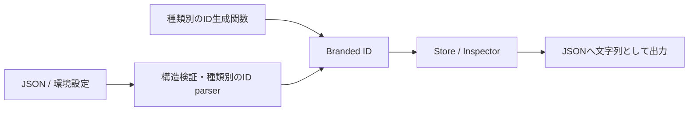

# DevTools IDへのBranded Types導入

- 状態: 採用
- 日付: 2026-10-26
- 対象: `@loutrejs/loutre/devtools`、Node adapter、CLI
- 関連: [Browser DevToolsのアーキテクチャ](loutre_browser_devtools_architecture.md)
- 関連: [CoreのApplication Model IDへのBranded Types導入](loutre_core_branded_ids.md)
- 全体方針: [Loutre全体へのBranded Types導入](loutre_branded_types_adoption.md)

## 背景

DevToolsではRun、Trace、Span、Replay capsule、Inspector commandを別々のIDで識別するが、型はすべて`string`になっている。`ReplayCapsuleStore.createExecution(traceId, spanId, ...)`の引数を交換したり、Trace IDでCapsuleを検索したりしてもコンパイルが通る。文字列の接頭辞はデバッグに役立つが、呼び出し側の取り違えを防げない。

型の所有者をDevToolsに置き、生成・受信から保存・検索・応答までIDの種類を保持する。Core Runtimeは引き続きgenericなinstrumentation boundaryだけを認識する。

## 決定

### IDの種類と所有者

`packages/loutre/src/devtools/identity.ts`を型と境界用parserの正本にし、既存の`@loutrejs/loutre/devtools`から公開する。Node adapterとCLIに同じbrandを再定義しない。

| 型                   | 意味                                    | 生成・確定する場所                          |
| -------------------- | --------------------------------------- | ------------------------------------------- |
| `RunId`              | ApplicationのDevTools session           | Node adapter、またはinstrumentationの既定値 |
| `TraceId`            | 一つのTrace                             | instrumentationのexecution開始              |
| `SpanId`             | Trace内のSpan                           | instrumentationのexecution / operation開始  |
| `CapsuleId`          | Replay capsule                          | Replay capsule store                        |
| `InspectorRequestId` | CLIからApplicationへのcommandとその応答 | CLI Control Plane                           |
| `CaptureHandleId`    | 同一process内のcapture参照              | Replay capsule store                        |

`parentSpanId`も`SpanId`、`sourceTraceId`と`replayedFromTraceId`も`TraceId`にする。役割が違っても同じ識別対象を参照する値には、同じ型を使う。

BrowserからCLIへのrequest envelopeの`id`はInspector commandの`requestId`とは別の相関IDである。ここは`ControlRequestId`としてclient channel内で区別する。BrowserとCLIはJSONで通信するため、両者のTypeScript brandを共有する必要はない。

CLIが`LOUTRE_DEV_RUN_ID`へ設定する値はsessionを確定する前のseedである。CLI側の変数名を`runIdSeed`にし、Node adapterが再起動ごとのUUIDを付加した値を`RunId`にする。seed専用のbrandは設けない。

### 型の表現

```ts
type DevtoolsId<Kind extends string> = string & {
  readonly '~loutre.devtools-id': Kind
}

export type RunId = DevtoolsId<'run'>
export type TraceId = DevtoolsId<'trace'>
export type SpanId = DevtoolsId<'span'>
export type CapsuleId = DevtoolsId<'capsule'>
export type InspectorRequestId = DevtoolsId<'inspector-request'>
export type CaptureHandleId = DevtoolsId<'capture-handle'>
```

`DevtoolsId`は公開せず、個別の型を公開する。型キーを安定した名前にする理由は[全体方針](loutre_branded_types_adoption.md)に従う。汎用の`brand<T>()`や`asId<T>()`は提供しない。実体は文字列なので、JSON、ログ、URL、既存の文字列操作にそのまま渡せる。文字列加工の結果は新しい値として境界で扱い直す。

### 生成と受信の境界

境界用APIは`parseRunId(value: unknown): RunId | undefined`のような種類別のparserにする。Trace、Span、Capsule、Inspector requestにも対応するparserを用意する。Capture handleはprocess外から復元しないため、型だけを公開し、生成はstore内部に閉じる。

parserは文字列かどうかを確認し、入力を変更せず返す。ここでのbrandはIDの種類を表し、実在性や権限を保証しない。接頭辞、UUID形式、空文字の拒否、trimなどの新しい制約は導入しない。既存のControl Planeが持つ空文字の拒否などは、その境界の条件として維持する。

接頭辞を必須にしない理由は、公開APIから指定するRun IDやInspector request IDに任意の文字列を使えること、Node sessionのRun IDがseedとUUIDの組み合わせであることによる。parserに渡した文字列が、元は別種類のIDだったかどうかは実行時には判定できない。parserは意味を確定する境界だけで使用する。

UUIDを使う生成関数は`identity-internal.ts`に置く。`createTraceId(): TraceId`などの種類別関数にし、現在の生成形式を維持する。Node adapterのsession確定は、組み立てた文字列を`parseRunId`へ渡す。CLIのInspector request生成は、既存の`request_${crypto.randomUUID()}`を専用関数で包む。



JSONの受信値は`unknown`として扱う。既存の`isHelloMessage`、`isCommandResultMessage`、`parseInspectorCommand`などの検証境界でIDを解釈し、戻り値の型にbrandを保持する。既存objectをnarrowする場合も、新しいobjectを返す場合も、brandedなフィールドを検証なしのcastで主張しない。

特にApplication channelの`isRuntimeEvent`は現在、共通フィールドの一部しか検証していない。brandを付けるときは、optionalな`parentSpanId`、`capsuleId`、Replay元のIDも存在すれば検証する。イベントのdiscriminantごとの必須フィールドも確認し、部分的な検証でイベント全体の型を保証したことにしない。正規に生成されたmessageの形式は変えず、不正なmessageの拒否は検証の修正としてテストする。

### 保存・検索・公開API

Runtime event、Trace context、Replay context、Inspector request/result、Capsule preview、CLIのsummary型まで同じID型を使う。`executionId`と`graphNodeId`もCoreが所有する型を引き継ぐ。時刻・duration・TTL・sequence・capture上限についても、[全体方針](loutre_branded_types_adoption.md)に従って意味と単位を区別する。

代表的な変更後の契約は次のとおり。

```ts
createExecution(
  traceId: TraceId,
  spanId: SpanId,
  observation: RuntimeExecutionMetadata,
  registration: ReplayRegistration,
): ExecutionReplayCapsulePreview

traceEvents(traceId: TraceId): readonly RuntimeEvent[]
findCapsule(capsuleId: CapsuleId): DevtoolsCapsuleSummary | undefined
command(runId: RunId, command: DevtoolsApplicationCommand): Promise<unknown>
```

Storeのkeyにも`Map<RunId, ...>`、`Map<CapsuleId, ...>`、`Map<CaptureHandleId, ...>`、`Map<InspectorRequestId, ...>`を使う。Capsuleのevictionなどでkeyを取り出す際も、現在の`as string`でbrandを消さない。

IDを受け取る内部APIやInspectorの公開APIに`string`を許すoverloadは追加しない。`RuntimeObserver.runId`も`RunId`へ変更し、任意の文字列を指定する利用者は公開parserで変換する。従来のイベントを読むコードは引き続き文字列として扱えるが、イベントやrequestを手書きするコードには移行が必要になる。

## 互換性と寿命

JSONのfield名、IDの生成形式、`DEVTOOLS_PROTOCOL_VERSION`は維持する。TypeScriptで文字列を直接渡すコードには破壊的変更となるため、[全体方針の移行案内](loutre_branded_types_adoption.md#互換性と移行)に従う。parserの追加は、この移行の正式な入口にもなる。

brandはIDの種類だけを区別する。同じ種類のIDについて、別Runの値、期限切れのCapsule、未接続のRun、未知のrequestを区別しない。既存のRun照合、lookup、TTL、切断時のpending cleanupを維持する。`RunId`の型パラメータを他のIDへ伝播させる設計は、process間の動的なsession切り替えに対して複雑さが大きいため採用しない。

## 導入範囲と順序

1. **DevToolsの型・生成・store**: `identity.ts`、`identity-internal.ts`を追加し、`observer.ts`、`inspector.ts`、`capsule.ts`、`runtime.ts`、public facadeへ反映する。
2. **Node adapterとCLI**: Nodeのsession確定とcommand parser、CLIのControl Plane、Application channel、EventStoreへ型を伝播する。Control channelの相関IDもInspector request IDから分ける。1と2は同じ変更として型整合を完成させ、通常処理で再brandが必要な箇所を残さない。
3. **Browser側へ適用**: 現在のWebsiteはRuntime eventなどを独立した型で定義し、Loutre packageへ依存していない。この構成を維持し、Website内の`devtools-identity.ts`を正本に、JSON受信・URL queryの読み込みからstate・API呼び出しまで同様の型を通す。`ControlRequestId`はBrowserのpending mapに使う。URL parserが持つ既存のtrim規則はそこで維持する。

DevToolsの完了範囲にはWebsiteも含める。変更を分ける場合は1・2を先行できるが、Websiteを任意の追加対象にはしない。共有型のためだけにWebsiteへpackage依存や事前buildを追加しない。

Application ModelとGraph IRのnode IDは、[Coreの設計案](loutre_core_branded_ids.md)で扱う。DevToolsもCoreが公開するModel IDをそのまま参照し、同じModel nodeにDevTools固有のGraph IDを作らない。一方、CLIのGraph viewとWebsiteの描画用IDには独自の型が必要であり、その区別は全体方針に含める。HTTP dispatch keyとGraphQLのbatch keyなども全体の採用範囲とする。

## 検証方針

実装時に以下を確認する。

- 型テストで、通常の`string`や`SpanId`を`TraceId`の引数へ渡せないこと、別種のIDでMapを検索できないこと、`ControlRequestId`と`InspectorRequestId`を交換できないことを確認する。parserで得た値は、文字列として利用できることも確認する。
- parserが文字列を変更せず返し、非文字列を拒否することを確認する。既存の任意形式のIDとNodeのseed付きRun IDを含める。
- 受信messageのIDフィールドを種類ごとに検証する。optionalなIDが非文字列の場合も拒否し、不正なdiscriminant別フィールドを通さない。
- CapsuleのReplay・TTL・eviction、Inspectorの応答照合、再接続・切断時のpending cleanupを既存のDevTools unit / integration testで確認する。fixtureはparserか型付きのfixture helperで構築し、無検証のcastへ置き換えない。
- `npm run check`、`npm run test:types`、`npm run check:dependencies`と関連するDevTools testを実行する。buildで公開宣言の出力も確認する。

## 採用しない案

- **すべての文字列へ同じbrandを付ける**: 型の所有者と有効範囲が異なる。全体に導入する場合も、それぞれのdomainが意味を確定する。
- **呼び出し箇所へ`as TraceId`を追加する**: 間違ったIDでも通せるため、生成と検証の責務が分散する。
- **`TraceId | string`を受け取る**: ほかのbranded IDも`string`として渡せるため、取り違えを防ぐ契約にならない。
- **IDごとのclass wrapperを使う**: JSONやURLへの変換が増える。今回の目的は種類の区別であり、値objectとしての操作は不要である。
- **CoreへDevTools固有のIDとparserを集約する**: TraceやCapsuleの責務をCoreへ引き上げない。共通の型演算だけを内部utilityへ置く方針とは区別する。
