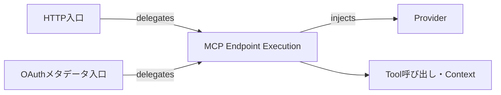

# LoutreのMCP endpoint設計

ステータスはAccepted。

## 決定

MCPはGraphQLと同じく、endpointのExecutionがruntimeとDIを所有する。単一のHTTP listenerに複数のMCP endpointを配備でき、各endpointのTool一覧、OAuth設定、共有状態、中断処理を分離する。HTTP Contractの公開ルートとOAuthメタデータの入口は、そのendpointへdelegateで接続する。

Toolは公開名、scope、入出力schemaを持つ契約とし、実装はendpointのfactoryが返すhandlerに置く。Application Modelにはendpointとtransportを登録し、呼び出しごとのTool処理はtransport配下のoperationとして追跡する。Tool単位のExecution、ModuleへのTool登録、ToolごとのDI resolverは追加しない。

Toolを個別Executionにする案は、ToolごとのModule境界が必要な場合には有効だが、今回の要件ではendpointのDIと呼び出しContextで状態を渡せる。GraphQLと同じ責務を異なるModelの粒度と生成規則で扱う理由がないため、endpointへ集約する。

## 公開API

`mcp.tool()`で契約を宣言し、`mcp.implementation()`のfactoryでDI、OAuthの検証処理、Context生成、Toolの実装を組み立てる。SDK固有の型は公開しない。MCPパッケージはCoreをpeer dependency、SDKを内部依存として持つ。

```ts
const readOrder = mcp.tool({
  name: 'orders.read',
  description: '注文を取得する',
  scopes: ['orders:read'],
  input: z.object({ id: z.string() }),
  output: z.object({ status: z.string() }),
})
const orders = mcp.implementation({
  name: 'orders',
  version: '1.0.0',
  route: Api.routes.orders,
  tools: [readOrder],
  oauth: { requiredScopes: ['orders:read'] },
  factory: (service = inject(OrdersService), auth = inject(AuthService)) => ({
    oauth: auth.mcp,
    context: ({ principal, signal, state }) => ({ principal, signal, state }),
    tools: {
      'orders.read': async ({ id }, { principal, signal }) => ({
        status: await service.status(id, { principal, signal }),
      }),
    },
  }),
})
```

Toolの入力変換後の型と、出力schemaが受け付ける型をhandlerへ対応付ける。異なるToolをまとめる境界ではschemaとhandlerを検証し、`as never`などで型を合わせない。Tool名の重複はendpoint内で拒否し、別endpointで同じ公開名を使うことは許可する。

## Application ModelとDI

endpointのfactoryから依存を収集し、そのendpointのModule visibilityで検証する。HTTP middlewareの依存はHTTP Executionが所有する。Toolの契約とJSON Schemaはendpointのcompiled metadataへ記録し、GraphとSDK応答の正本にする。



GraphQLと同様に、Modelに登録する宣言と呼び出し時のoperationは分ける。endpoint名はApplication内の識別子とし、重複はCoreのExecution ID検証で拒否する。Tool名はendpoint内の公開名である。

## 状態の寿命

| 状態                                                             | 生成・共有の単位                                                  |
| ---------------------------------------------------------------- | ----------------------------------------------------------------- |
| endpoint runtime、OAuthの検証処理、Tool handler、factory内の状態 | Application × endpoint                                            |
| factoryで注入して保持するtransient Provider                      | endpoint生成時に取得し、そのendpointの呼び出し間で共有する        |
| application scopeのProvider                                      | 同じProvider登録を利用するApplication内で共有する                 |
| middleware state、検証済みprincipal、期限と中断signal            | HTTP requestごと                                                  |
| ToolのContext                                                    | 認可と入力検証を通ったTool呼び出しごとに`context()`を実行して得る |

Contextの入力へ元のRequest、middleware state、principal、signalを渡す。認証主体をfactoryの共有変数へ保存しない。`context()`が同じobjectを返した場合は、そのobjectが共有される。呼び出しごとに分ける可変状態はContext内で構築する。

factoryは依存収集でも呼ばれるため、外部I/Oを行わない。実体の生成は起動時にendpointごとに一度行い、Definitionやmodule-levelのcacheへ保存しない。

## 認可とTool実行

Streamable HTTPとOAuthリソースサーバーを提供する。HTTP Contractは静的なrawルートを所有し、endpointはそこからProtected Resource MetadataのGETルートを導出する。通常HTTP、MCP入口、メタデータは同じルート表で衝突を検証する。

Bearer tokenの発行元、対象リソース、有効期限、scopeを確認する。`runtime.oauth`が公開HTTPS origin、認可サーバー、`verifyAccessToken`、`allowInvocation`を供給する。各endpointは自身の公開URLと検証設定を使う。

Toolの一覧と直接呼び出しに同じscope条件を使い、認可前にContextやhandlerを実行しない。scope不足は`403 insufficient_scope`、レート制限は429とする。Host、Origin、サイズと実行期限の検査はMCPが担当する。

入力と出力はStandard Schemaで一度ずつ検証し、JSON SchemaはModel構築時に確定する。入力はobject schemaを要求する。公開可能な業務エラーは`mcp.toolError()`を使い、不正な入力とともに`isError: true`で返す。未知のToolはJSON-RPCエラー、想定外の例外と出力違反は一般化した内部エラーとする。

## 中断と終了

各endpointが中断状態を所有し、Kernelのdrainで全endpointへ中断を伝える。HTTP ExecutionのLeaseを外側の寿命とし、Tool呼び出しを`beginOperation()`で追跡する。

SDKが中断応答を先に返しても、開始済みのToolとContextの処理完了を待ってからHTTP handlerを終了する。signalの通知と処理の完了は区別し、非協調的なhandlerが残る間はKernelがProviderを保持する。active executionの完了後にendpoint runtimeをcloseする。

## 検証

複数endpointを同じlistenerへ配備し、同名Tool、OAuthメタデータ、認可、Context、DIと中断の分離を確認する。同じDefinitionから複数Applicationを起動した場合もruntimeを分離する。

型テストでTool名、入力変換、出力変換、middleware state、Contextの推論を確認する。統合テストではContext生成の単位、共有状態、scope不足時の短絡、handler例外、SDK中断後の完了待機を確認する。

stdio、Resources、Promptsは後続とする。
