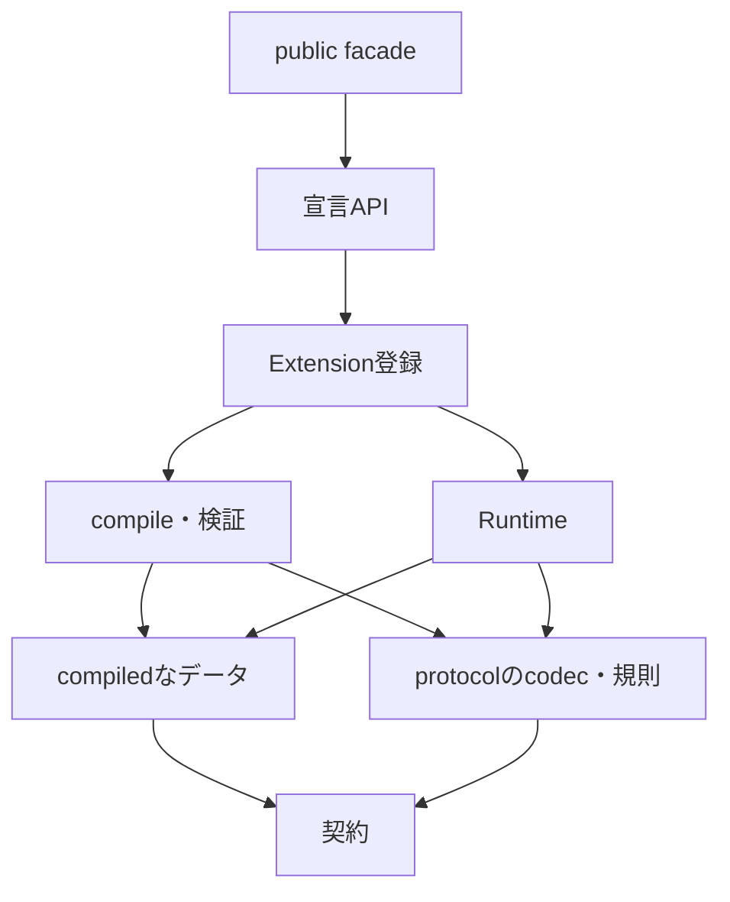

# 責務境界の判別可能な契約

ステータスはAccepted。

## 決定

フレームワーク内の責務境界で複数種類の要求・結果を渡す場合、受け手が所有する閉じた判別可能unionで表す。要求・結果そのものの種類は`kind`、処理の状態は`status`とする。`transport`など意味のあるドメイン属性は固有の名前を維持し、その属性をunionの判別にも利用できる。受け手は`ts-pattern`の`match(...).exhaustive()`で全種類を処理する。

| 契約                         | 表現                                                |
| ---------------------------- | --------------------------------------------------- |
| 要求・結果そのものの種類     | literalな`kind`と、その種類で必要な値を持つunion    |
| 経路などのドメイン固有の属性 | `transport`など意味を表す名前を維持する             |
| 実行中・終了などの処理状態   | `status`                                            |
| 複数種類を持たない処理       | 型付きの関数契約                                    |
| 外部規格・公開wire protocol  | 規格のフィールド名を維持し、adapterで検証・変換する |

`kind: string`、複数のoptional field、プロパティの有無では内部の種類を表さない。closed unionを拡張したときは、未対応の受け手を型エラーにする。未対応の種類を既存の処理へ暗黙に流すfallbackは置かない。

## 責務と依存方向

unionはその責務の範囲で閉じる。CoreへGraphQL、MCPなどのprotocol一覧を追加しない。Extension名やoperation名など、拡張可能な識別子は引き続き開いた型で扱う。単一の汎用message busへ全処理を集めない。

public DSLの省略記法や外部入力を解釈する場合は、入口で検証して内部契約へ変換する。構造の検査はその境界へ限定し、内部で同じプロパティの存在判定を繰り返さない。型assertionによって検証を省略しない。

## 宣言・compile・Runtime

handlerの取得方法は`kind: 'factory' | 'delegate'`の契約とする。Coreが依存収集とbindingの構築を所有し、各transportはその結果を利用する。Extensionはcompile contextにhandlerを登録し、Runtimeで使うresolverだけを受け取る。依存と委譲の情報はCoreがcanonical Application Modelへ集約し、Extensionがhandlerから転記する方式は採用しない。middlewareのfactoryも同じcontextで依存を収集する。factoryを使わず明示的に解決するProviderだけは、Contributionで依存を直接宣言する。

factoryは起動時に参照元ExecutionのDIで実体を作り、delegateは呼び出し時に宣言済みの委譲先を解決する。

この違いはcompile境界で一度処理し、Runtimeは共通のhandler resolverを使う。宣言へ依存収集・handler構築の任意callbackを埋め込む方式は、種類と必要な値の対応を型から確認できず、HTTPとWebSocketに同じDI処理が重複するため採用しない。

TasksはCoreの`ExecutionDefinition.kind`とTasks自身の種類を混在させない。Tasksの宣言payloadとcompiled payloadが、それぞれTasksの`kind`を持つ。WebSocket frameの`text`／`binary`は表現形式を表す既存の`type`を維持し、codecとframeの組合せを網羅的に処理する。入力検証結果は`kind`で区別する。HTTPのrawと契約付きrouteはcompile後も区別できる契約を持つ。

MessagePort Runtimeは`kind: 'unary' | 'stream'`の実行結果を返し、transportはそのkindに従ってwire messageへ変換する。値がAsyncIterableかどうかでtransportが応答形式を再判定すると、unaryとして検証済みの値までstreamとして扱うため採用しない。

HTTP・WebSocket・MessagePort・MCPのhandlerは、契約に宣言した文字列名でmethodを取得し、返却元のオブジェクトをreceiverとして呼び出す。Coreはインスタンスとprototypeのproperty descriptorを調べ、非列挙のものも含めて、契約にない文字列名の関数を拒否する。getterの評価は宣言名を解決するときに限る。Symbolキーは検査対象から外す。各Runtimeはprotocol固有の引数と結果を検証する。

MCPの成功・業務エラーなど、既に`kind`を持つ結果も受け手で網羅的に処理する。GraphQL AST、MCP content、JSON Schema、DOM event、Promiseのsettled resultなどは外部の契約に従う。DevToolsのwire protocolも送受信で共有する仕様に従い、フィールド名だけを内部規約へ機械的に変更しない。

GraphQL Context入力のHTTP／WebSocketは、同じGraphQL呼び出しがどの経路から来たかを表すため、`transport`で判別する。GraphQL operationそのものの種類は外側の実行metadataの`kind`が表す。Context専用の関数契約へ重複する`kind`を追加したり、`transport`を改名したりしない。網羅性はプロパティ名に依存しない。

## 保証する範囲

網羅性は種類の処理漏れを防ぐ。処理内容、状態遷移、認可、DIの所有権、resourceの寿命は振る舞いのテストで検証する。abort通知と処理完了を区別し、宣言時にApplicationの実体を作らない。

HTTP・MessagePort・GraphQLで共通のiterator操作とcleanupはCoreの`AsyncIteratorLifecycle`が追跡する。protocolごとのLeaseの所有権は各Runtimeに残し、cleanupの完了と開始済みの操作の完了を両方確認する。中断で待機者へ結果を返す場合も、元のPromiseを完了待機の対象から外さない。

型テストでは、未知のkind、不足するpayload、kindとpayloadの不正な組合せ、未網羅のmatchを拒否する。統合テストでは、factoryの生成と共有の単位、delegateの遅延解決、ModuleごとのDI、HTTPとWebSocketの中断・終了、Tasksの各trigger、外部protocolの送受信を確認する。

## ソースコードの責務境界

Extensionの登録、宣言API、契約、compile済みデータ、実行時の処理を別moduleにする。`extension.ts`へ全処理を集めると、契約を参照するだけの呼び出し元がRuntimeの実装へ依存し、状態の所有者と依存方向を確認しにくくなるため採用しない。

契約とcompile済みデータは実行中の状態を所有しない。宣言APIはCoreのDefinitionを構築し、ExtensionはcompileとRuntimeを接続する。要求や接続の受付、handlerの実行、stream・session・triggerの終了待機は、それぞれのRuntimeが所有する。schemaの変換やcodecは実行状態から分離し、compileとRuntimeが同じprotocolの規則を参照する。

内部moduleは自身のpublic facadeや宣言APIへ逆依存しない。契約・compile済みデータからRuntimeへも依存しない。別packageの契約を利用する場合は、そのpackageのpublic APIから参照する。この境界は依存検査で保証する。既存テストの内容と期待値を維持して再構成し、保証が不足している振る舞いや依存方向の検証は追加する。

依存検査は`contract.ts`と`compiled.ts`に加え、GraphQL・MCPの`types.ts`など実際に契約を所有するmoduleも対象にする。検査のテストでは実在する契約moduleを起点に、実行実装・宣言API・自身のpublic facadeへの逆依存を拒否することを確認する。

## 関連する判断

- [Execution Extension契約](./loutre_execution_extension_contract_architecture.md)
- [構築とRuntimeの所有権](./loutre_construction_and_runtime_ownership.md)
