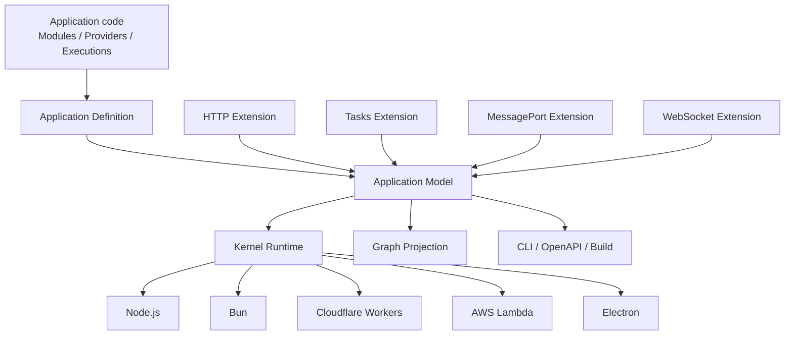

# Loutre Architecture

Loutreは **TypeScript Application Graph Kernel** です。Applicationの構造は一度だけ`Application Model`へcompileされ、Runtime execution、CLIのGraph inspection、OpenAPI projection、deployment toolingが同じmodelを参照します。

最初のApplicationを作る場合は[Getting Started](./getting-started.md)から始めてください。

## Overview



Coreが所有するのはportableなApplication concernだけです。

- Application Definitionとcanonical Application Model
- Module boundaryとProvider / DI
- EnvironmentとArguments
- Lifecycle
- active execution lifetime
- Runtime Capability identity
- generic Layer composition
- diagnosticsとGraph projection

HTTP、Task、MessagePort、WebSocket、Queue consumerなどのexecution semanticsはExecution Extensionが所有します。Coreがprotocol identityで分岐することはありません。

## Packages

| 公開package        | Role                                                         |
| ------------------ | ------------------------------------------------------------ |
| `@loutrejs/loutre` | Application Graph Kernel、DI、Lifecycle、Runtime abstraction |
| `@loutrejs/node`   | Node.js Runtime Adapter                                      |
| `@loutrejs/bullmq` | BullMQ Queue Consumer Driver                                 |
| `@loutrejs/cli`    | Graph inspection、validation、build、deployment tooling      |
| `create-loutre`    | project initializer                                          |

main packageの主要subpathは次の通りです。

公開packageとsubpathを分ける判断理由は[package配布architecture ADR](../adr/loutre_package_distribution_architecture.md)を参照してください。

| Subpath                         | Role                                                 |
| ------------------------------- | ---------------------------------------------------- |
| `@loutrejs/loutre`              | Application、Module、DI、Lifecycle、Kernel bootstrap |
| `@loutrejs/loutre/http`         | HTTP Extension                                       |
| `@loutrejs/loutre/tasks`        | Tasks Extension                                      |
| `@loutrejs/loutre/message-port` | MessagePort Extension                                |
| `@loutrejs/loutre/websocket`    | WebSocket Extension                                  |
| `@loutrejs/loutre/graph`        | Application ModelのGraph projection                  |
| `@loutrejs/loutre/runtime`      | Runtime CapabilityとKernel runtime primitive         |
| `@loutrejs/loutre/http/openapi` | OpenAPI projection                                   |
| `@loutrejs/loutre/presentation` | startup presentation                                 |
| `@loutrejs/loutre/runtime/*`    | portable Runtime adapter                             |

## Application DefinitionとModel

`defineApplication()`はcanonical modelをその場で構築します。

```ts
const application = defineApplication({
  modules: [AppModule],
  arguments: AppArgs,
})
```

Application Definitionはlistener、timer、processを所有しません。RuntimeとToolingの唯一の正本になるcompile済み`model`を保持します。

ModuleにはProviderとExecution Definitionを登録します。

```ts
const AppModule = defineModule({
  environment: [AppEnv],
  providers: [UsersService],
  executions: [UsersHttp, heartbeat],
})
```

Execution Definitionは所有するExtensionでbrandされます。Model構築時にExtensionがdependency edge、必要Runtime Capability、compiled payload、Graph metadataをprotocol-neutralなexecution contributionへcompileします。Extensionは同じExtension内のexecution参照も公開でき、Coreがそのclosureを再帰的に辿るため、Triggerだけを登録すれば参照先Taskも自動でModelへ含まれます。compile済みModelへraw Definitionは保持しません。

## HTTP Extension

HTTP semanticsは`@loutrejs/loutre/http`が所有します。

```ts
import { http } from '@loutrejs/loutre/http'
import { z } from 'zod'

export const UsersContract = http.contract({
  get: {
    method: 'GET',
    path: '/users/{id}',
    request: {
      params: { id: z.string() },
    },
    responses: {
      found: {
        status: 200,
        body: z.object({ id: z.string(), name: z.string() }),
      },
    },
  },
})

export const UsersHttp = http.implementation({
  name: 'UsersHttp',
  contract: UsersContract,
  factory: (users = inject(UsersService)) => ({
    async get(ctx) {
      return ctx.response.found({
        body: await users.get(ctx.input.params.id),
      })
    },
  }),
})
```

routing、request decode、response finalization、middleware、authentication helper、CORS、streaming、OpenAPI metadataはHTTP Extensionの責務です。Application ModelはHTTP固有構造を解釈しません。

## Tasks Extension

Task、Trigger、Queue Consumerは`@loutrejs/loutre/tasks`が所有します。

```ts
import { fixedDelay, task } from '@loutrejs/loutre/tasks'

export const cleanup = task<void, void>({
  name: 'cleanup',
  factory: () => async () => {
    // work
  },
})

export const heartbeat = fixedDelay({
  name: 'heartbeat',
  delay: 5_000,
  immediate: true,
  task: cleanup,
})

const WorkerModule = defineModule({
  executions: [heartbeat],
})
```

Tasks executionを含むApplicationにはExtension-ownedな`tasks` Host APIが合成されます。

```ts
const app = await bootstrapApplication({ application })
await app.tasks.run(cleanup)
await app.tasks.start()
```

## MessagePortとWebSocket

MessagePortは`@loutrejs/loutre/message-port`、WebSocketは`@loutrejs/loutre/websocket`が提供し、それぞれのexecution model、runtime、Host API、Graph projectionを所有します。WebSocketはHTTP upgrade handshakeのためpublicなHTTP Extension surfaceにも依存しますが、Coreはtransport非依存のままです。

## DIとModule visibility

Providerは既定でapplication scopeです。`inject()`で宣言したdependencyはApplication Modelへ記録されます。

```ts
class UsersService {
  constructor(readonly repository = inject(UserRepository)) {}
}
```

別ModuleのProviderへ依存する場合は`exports` / `imports`を明示します。visibilityはRuntime起動前のModel構築時に検証されます。

### 独自loggerなどで依存元を取得する

`injectInquirer()`は、同期的なprovider構築中にそのproviderを直接要求したconsumerを返します。class providerとfactory providerの両方で使えます。class・custom tokenはそのtoken自体、Executionからの要求は`id`・`name`を持つdescriptorです。別名tokenで登録したconsumerでは、implementation classではなく登録tokenを返します。

```ts
import { inject, injectInquirer, provide } from '@loutrejs/loutre'
import { Logger } from '@loutrejs/loutre/runtime'

class AppLogger {
  readonly consumer = injectInquirer()
  readonly logger = inject(Logger)
}

const loggerProvider = provide(AppLogger).useClass(AppLogger, {
  scope: 'transient',
})
```

`ServiceA`が`inject(AppLogger)`すると`AppLogger.consumer`は`ServiceA`になります。組み込みLoggerの`context.source`は従来どおり`AppLogger`です。factory providerでも`use`内から取得でき、依存は従来どおり`inject: [...]`で宣言します。

Applicationの初期構築などconsumerがいない直接解決時と注入context外では`undefined`です。application scopeは共有されるため、consumerごとのmetadataが必要ならtransientを使ってください。取得した値は構築時に保存し、非同期処理の中から取得しないでください。`injectInquirer()`はloggerのラベルなどの構築metadata専用です。Model構築時の依存収集にはconsumerが存在しないため、`inject()`するtokenや依存の有無をこの値で分岐させることはAPI contract外です。metadataを保存するコードと依存の宣言を分け、必要な依存は無条件で宣言してください。

たとえば`injectInquirer() ? inject(Repository) : undefined`は利用できません。このような契約違反を自動検出・拒否する機構は未実装で、[Issue #139](https://github.com/come25136/loutrejs/issues/139)でModelとRuntimeの一致を検証する方針を扱います。

## EnvironmentとArguments

Runtime inputはtyped contractとして宣言し、Provider constructionより先にbindします。

```ts
class AppEnv extends defineEnv(
  z.object({ PORT: z.coerce.number().int().positive() }),
) {}

const AppModule = defineModule({
  environment: [AppEnv],
})
```

Runtime adapterが実環境のsourceを渡し、testやembedded executionでは`bootstrapApplication()`へ明示sourceを渡せます。

## RuntimeとLifecycle

portableなKernel-hosted Applicationは`bootstrapApplication()`で起動します。

```ts
const app = await bootstrapApplication({ application })
```

Runtime adapterはその外側でplatform ownershipを追加します。Node.js / BunではHTTP listenerとprocess signalの終了フックをadapterが所有し、HTTPを持たないworkerにも同じ終了処理を適用します。`create({ shutdownHooks: false })`で終了フックを無効にできます。

```ts
const app = await nodeRuntime.create({ application })
await app.serve({ port: 3000 })
```

shutdownはExtension-owned workとactive executionをdrainし、active executionが0になってからExtension runtimeをcloseします。その後のProvider lifecycle cleanupは`onModuleDestroy`、`beforeApplicationShutdown`、`onApplicationShutdown`の順で実行します。drainの成否にかかわらずactive executionの待機が`forceShutdownTimeoutMs`を超えた場合は、利用中のProviderをcleanupせずApplicationを`draining`に保ちます。

## GraphとTooling

CLIはApplication Definitionのcompile済みmodelを読み、別のarchitecture representationを再構築しません。

```sh
loutre check --entry src/app.ts
loutre graph modules --entry src/app.ts
loutre graph di --entry src/app.ts --format mermaid
loutre graph executions --entry src/app.ts --format json
loutre doctor --entry src/app.ts --runtime node
```

OpenAPIもExecution Extensionのprojectionです。CoreはHTTP route semanticsを知りません。

Provider構築、Module正規化、終了フックの責務を分けた判断は[所有権ADR](../adr/loutre_construction_and_runtime_ownership.md)を参照してください。

## Design invariant

canonical Application Modelは一つだけです。Runtime adapter、CLI、build、Graph projection、Execution ExtensionがApplicationの並行modelを持つことはありません。
