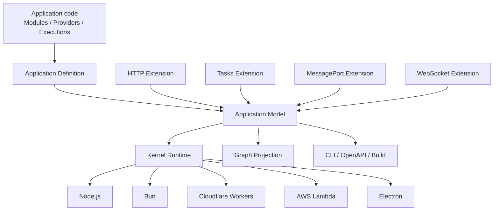

# Loutre Architecture

Loutreは **TypeScript Application Graph Kernel** です。Applicationの構造は一度だけ`Application Model`へcompileされ、Runtime execution、CLIのGraph inspection、OpenAPI projection、deployment toolingが同じmodelを参照します。

最初のApplicationを作る場合は[Getting Started](./getting-started.md)から始めてください。

## Overview



Coreが所有するのはportableなApplication concernだけです。

- Application Definitionとcanonical Application Model
- Module boundaryとProvider / DI
- EnvironmentとArguments
- Lifecycle
- active execution lifetime
- Runtime Capability identity
- generic Layer composition
- diagnosticsとGraph projection

HTTP、Task、MessagePort、WebSocket、Queue consumerなどのexecution semanticsはExecution Extensionが所有します。Coreがprotocol identityで分岐することはありません。

## Packages

| 公開package        | Role                                                         |
| ------------------ | ------------------------------------------------------------ |
| `@loutrejs/loutre` | Application Graph Kernel、DI、Lifecycle、Runtime abstraction |
| `@loutrejs/node`   | Node.js Runtime Adapter                                      |
| `@loutrejs/bullmq` | BullMQ Queue Consumer Driver                                 |
| `@loutrejs/cli`    | Graph inspection、validation、build、deployment tooling      |
| `create-loutre`    | project initializer                                          |

main packageの主要subpathは次の通りです。

公開packageとsubpathを分ける判断理由は[package配布architecture ADR](../adr/loutre_package_distribution_architecture.md)を参照してください。

| Subpath                         | Role                                                 |
| ------------------------------- | ---------------------------------------------------- |
| `@loutrejs/loutre`              | Application、Module、DI、Lifecycle、Kernel bootstrap |
| `@loutrejs/loutre/http`         | HTTP Extension                                       |
| `@loutrejs/loutre/tasks`        | Tasks Extension                                      |
| `@loutrejs/loutre/message-port` | MessagePort Extension                                |
| `@loutrejs/loutre/websocket`    | WebSocket Extension                                  |
| `@loutrejs/loutre/graph`        | Application ModelのGraph projection                  |
| `@loutrejs/loutre/runtime`      | Runtime CapabilityとKernel runtime primitive         |
| `@loutrejs/loutre/http/openapi` | OpenAPI projection                                   |
| `@loutrejs/loutre/presentation` | startup presentation                                 |
| `@loutrejs/loutre/runtime/*`    | portable Runtime adapter                             |

## Application DefinitionとModel

`defineApplication()`はcanonical modelをその場で構築します。

```ts
const application = defineApplication({
  modules: [AppModule],
  arguments: AppArgs,
})
```

Application Definitionはlistener、timer、processを所有しません。RuntimeとToolingの唯一の正本になるcompile済み`model`を保持します。

ModuleにはProviderとExecution Definitionを登録します。

```ts
const AppModule = defineModule({
  environment: [AppEnv],
  providers: [UsersService],
  executions: [UsersHttp, heartbeat],
})
```

Execution Definitionは所有するExtensionでbrandされます。Model構築時にExtensionがdependency edge、必要Runtime Capability、compiled payload、Graph metadataをprotocol-neutralなexecution contributionへcompileします。Extensionは同じExtension内のexecution参照も公開でき、Coreがそのclosureを再帰的に辿るため、Triggerだけを登録すれば参照先Taskも自動でModelへ含まれます。compile済みModelへraw Definitionは保持しません。

## HTTP Extension

HTTP semanticsは`@loutrejs/loutre/http`が所有します。

```ts
import { http } from '@loutrejs/loutre/http'
import { z } from 'zod'

export const UsersContract = http.contract({
  get: {
    method: 'GET',
    path: '/users/{id}',
    request: {
      params: { id: z.string() },
    },
    responses: {
      found: {
        status: 200,
        body: z.object({ id: z.string(), name: z.string() }),
      },
    },
  },
})

export const UsersHttp = http.implementation({
  name: 'UsersHttp',
  contract: UsersContract,
  factory: (users = inject(UsersService)) => ({
    async get(ctx) {
      return ctx.response.found({
        body: await users.get(ctx.input.params.id),
      })
    },
  }),
})
```

routing、request decode、response finalization、middleware、authentication helper、CORS、streaming、OpenAPI metadataはHTTP Extensionの責務です。Application ModelはHTTP固有構造を解釈しません。

## Tasks Extension

Task、Trigger、Queue Consumerは`@loutrejs/loutre/tasks`が所有します。

```ts
import { fixedDelay, task } from '@loutrejs/loutre/tasks'

export const cleanup = task<void, void>({
  name: 'cleanup',
  factory: () => async () => {
    // work
  },
})

export const heartbeat = fixedDelay({
  name: 'heartbeat',
  delay: 5_000,
  immediate: true,
  task: cleanup,
})

const WorkerModule = defineModule({
  executions: [heartbeat],
})
```

Tasks executionを含むApplicationにはExtension-ownedな`tasks` Host APIが合成されます。

```ts
const app = await bootstrapApplication({ application })
await app.tasks.run(cleanup)
await app.tasks.start()
```

## MessagePortとWebSocket

MessagePortは`@loutrejs/loutre/message-port`、WebSocketは`@loutrejs/loutre/websocket`が提供し、それぞれのexecution model、runtime、Host API、Graph projectionを所有します。WebSocketはHTTP upgrade handshakeのためpublicなHTTP Extension surfaceにも依存しますが、Coreはtransport非依存のままです。

## DIとModule visibility

`inject()`を使うと、必要なサービスをLoutreから受け取れます。このように、サービスが必要とする別のサービスを渡す仕組みをDI（依存性の注入）と呼びます。Loutreに登録するサービスや値をProviderと呼び、既定では一つのApplication内で同じinstanceを共有します（application scope）。

```ts
class UsersService {
  constructor(readonly repository = inject(UserRepository)) {}
}
```

別のModuleが持つサービスを使う場合は、提供側で`exports`、利用側で`imports`を指定します。これにより、どのModuleからサービスを利用できるかが決まります。この利用範囲をModule visibilityと呼びます。

### Modelの依存宣言と実行時の照合

LoutreはApplicationを起動する前に、`inject()`などから「どのサービスが、どのサービスを必要とするか」を調べます。その結果を記録したものがApplication Model（以下、Model）です。必要なサービスが登録されているか、別のModuleから利用してよいかを、この段階で確認します。

実行時にも、その要求元の依存としてModelに記録されたサービスかを確認します。Providerとして登録されていても、その要求元の依存として記録されていないサービスを実行時だけ要求すると、`LUTRE_DI_UNDECLARED_DEPENDENCY`で拒否されます。エラーには要求元と、要求されたサービスの識別子が含まれます。これは、事前の確認を通っていないサービスを利用させないための規則です。

記録したサービスを毎回すべて使う必要はありません。必要なサービスは常に同じように取得し、使うかどうかはメソッドやhandler内の処理で判断してください。

### 独自loggerなどで依存元を取得する

`injectInquirer()`は、今作っているサービスを直接要求した相手を返します。返された相手をconsumerと呼びます。ログに要求元の名前を付けるなどの補足情報（metadata）に使い、取得するサービスの切り替えには使わないでください。

**NG: 依存元の有無で`inject()`を分岐する**

```ts
class MyService {
  readonly repository = injectInquirer() ? inject(Repository) : undefined
}
```

事前に依存関係を調べる段階では、`injectInquirer()`は`undefined`です。そのため、この例の`Repository`は依存としてModelに記録されません。別のサービスから要求されるなど、実際の構築で依存元が存在し、この分岐から`Repository`を要求した時点で`LUTRE_DI_UNDECLARED_DEPENDENCY`になります。

**OK: 依存は無条件に宣言し、依存元の情報は別に保存する**

```ts
class MyService {
  readonly repository = inject(Repository)
  readonly consumer = injectInquirer()
}
```

`Repository`は事前に依存として記録されます。保存した`consumer`はログなどに使えます。条件によって`Repository`を使うかどうかを変えたい場合は、依存の宣言を分岐させず、実際の処理で分岐します。

```ts
class MyService {
  readonly repository = inject(Repository)

  loadUsers(enabled: boolean) {
    if (!enabled) return []
    return this.repository.findAll()
  }
}
```

#### consumer情報の形式と保存

`injectInquirer()`は、Providerを同期的に作っている間に使えます。要求元がクラスならそのクラス、登録用の識別子（custom token）ならそのtokenを返します。別名tokenで登録したサービスでは、実装クラスではなく登録tokenを返します。標準のAPIやTaskなどの処理からの要求では、`id`・`name`を持つオブジェクトを返します。

依存元がない直接の構築時や、サービスを作っている場面の外では`undefined`です。取得した値は構築時に保存してください。非同期処理の中で呼び直しても、その処理の要求元を追跡することはできません。

要求元ごとに異なる情報を保存する独自loggerには、要求のたびに新しいinstanceを作る`transient`を使います。application scopeでは、一つのinstanceと、構築時に保存したconsumerが共有されます。

```ts
import { inject, injectInquirer, provide } from '@loutrejs/loutre'
import { Logger } from '@loutrejs/loutre/runtime'

class AppLogger {
  readonly consumer = injectInquirer()
  readonly logger = inject(Logger)
}

const loggerProvider = provide(AppLogger).useClass(AppLogger, {
  scope: 'transient',
})
```

`ServiceA`が`inject(AppLogger)`すると、`AppLogger.consumer`は`ServiceA`です。組み込みLoggerの`context.source`は、そのLoggerを要求した`AppLogger`になります。factoryでも`use`内から`injectInquirer()`を使えますが、必要なサービスは登録時の`inject`配列で指定します。

### Providerの登録方法ごとのルール

| 登録方法                                         | 依存の指定方法と確認内容                                                                                                                                     |
| ------------------------------------------------ | ------------------------------------------------------------------------------------------------------------------------------------------------------------ |
| クラスを登録する（class provider）               | フィールドやconstructorの既定引数に書いた`inject()`から、必要なサービスを調べます。                                                                          |
| 関数でサービスを作る（factory provider）         | `inject: [...]`に必要なサービスを並べます。その順に`use`の引数へ渡されます。`use`内からの`inject()`は`LUTRE_DI_CONTEXT`で拒否されます。                      |
| 設定に応じてクラスを選ぶ（conditional provider） | 選択に使う環境設定・起動引数（Env / Args）と、選択候補すべてのクラスの依存を確認します。選ばれない候補も、別Moduleのサービスを利用してよいかの確認対象です。 |
| API・Taskなどの処理（Execution）                 | 標準のHTTP・Tasks・WebSocket・MessagePortでは、処理を組み立てる`factory`内の`inject()`から依存を調べます。実行時だけ別の依存を追加することはできません。     |

APIやTaskのhandlerでは、`factory`で取得したサービスを使います。handler内から`inject()`を呼んでサービスを取得する使い方はできません。

#### Env / Args・Logger・終了処理などの補足

- Env（環境設定）とArgs（起動時の引数）は、それぞれModuleの`environment`とApplicationの`arguments`に宣言します。`useValue()`で渡す値、Env、Args自体は、構築中に別のサービスを取得しません。
- 組み込み`Logger`はLoutreが提供するためProvider登録を省略できますが、利用側で`inject(Logger)`やfactoryの`inject: [Logger]`と宣言する必要はあります。すでに作成済みのサービスを受け取る場合も、依存の宣言は必要です。
- 初期化・終了処理のLifecycle hookは、`hook({ inject: [...], run: ... })`の`inject`配列で依存を指定します。
- HTTPのmiddleware（HTTP Layer）の依存も、所属するAPIの依存として調べます。必要なサービスはmiddlewareの`factory`で取得し、実行時だけ追加しないでください。

### 独自Execution Extension開発者向け

この節は、独自の処理形式をLoutreへ追加するExtensionの開発者向けです。標準のHTTP・Tasks・WebSocket・MessagePortを使うApplicationでは、この仕組みを意識した設定やAPI呼び出しは不要です。通常は前節までの`inject()`を使ってください。

独自Extensionでは、`compile()`が返す`dependencies`に、その処理（Execution）が必要とするProviderを記録します。Applicationの起動・終了を管理するKernelは、各Executionの宣言に対応する専用のResolver（Providerを取り出す関数）を生成します。

`createRuntime()`とHostの`create()`は、`executions`として`ExecutionRuntimeBinding`の配列を受け取ります。各要素は`{ execution, resolve }`です。`execution`はModelに記録されたExecutionへの参照、`resolve`はそのExecutionの依存宣言に対応する専用Resolverで、役割が異なります。

要素があることを確認したうえで`const { execution, resolve } = executions[0]!`のように取得し、`resolve(Service)`でProviderを取り出せます。複数のExecutionがある場合は、それぞれの要素に付いたResolverを使います。毎回`executionId`を渡す必要はありません。

次の例は、一つのExecutionを追加する最小例です。`compile()`の`dependencies: [Service]`と、`createRuntime()`の`resolve(Service)`が対応します。

```ts
import { defineExecutionExtension } from '@loutrejs/loutre'

class Service {
  greet() {
    return 'Hello'
  }
}

const greetingExtension = defineExecutionExtension({
  kind: 'execution-extension',
  name: 'example:greeting',
  abiVersion: '1',
  compile() {
    return {
      kind: 'execution',
      id: 'greeting',
      executionKind: 'example.greeting',
      dependencies: [Service],
      capabilities: [],
      compiled: null,
    }
  },
  createRuntime({ executions }) {
    const handlers = executions.map(({ execution, resolve }) => {
      const service = resolve(Service)
      return { id: execution.id, run: () => service.greet() }
    })
    return {
      handlers,
      close() {},
    }
  },
})
```

このExtensionを利用するときは、`Service`をModuleの`providers`へ、`defineExecution(greetingExtension, {})`を`executions`へ登録します。

`dependencies`にないProviderを`resolve()`で要求すると、取り出す前に`LUTRE_DI_UNDECLARED_DEPENDENCY`になります。`resolve()`の`source`はログ・診断用（既定値はExecutionのID）、`consumer`は要求されたProviderへ渡す構築時のmetadataです。たとえば`resolve(Service, { source: 'greeting', consumer })`と指定しても、依存宣言の照合先は変わりません。

HTTP LayerやQueue triggerなどへ解決処理を渡す場合も、所属するExecutionの同じResolverを引き継ぎます。`applicationRuntime`は実行・操作の追跡用で、`resolve()`を持ちません。

ResolverはApplicationごとにKernelが生成・管理します。bindingはModelへの参照とResolverを組み合わせた実行時用の値であり、Model自体にResolverや実行状態を保存するものではありません。Application終了後に保持していたResolverを呼ぶと`LUTRE_APPLICATION_STATE`になります。

責務の分担や、この構成を選んだ理由は[依存宣言の整合に関するADR](../adr/loutre_dependency_declaration_consistency.md)を参照してください。

#### 低水準のContainerを直接使う場合

通常のApplicationでは、KernelがProviderの依存宣言をContainerへ渡します。単独で`Container`を作る場合はModelを自動では受け取らないため、宣言を照合するには`ContainerOptions.dependencies`へModelのProvider依存一覧を渡す必要があります。

## EnvironmentとArguments

Runtime inputはtyped contractとして宣言し、Provider constructionより先にbindします。

```ts
class AppEnv extends defineEnv(
  z.object({ PORT: z.coerce.number().int().positive() }),
) {}

const AppModule = defineModule({
  environment: [AppEnv],
})
```

Runtime adapterが実環境のsourceを渡し、testやembedded executionでは`bootstrapApplication()`へ明示sourceを渡せます。

## RuntimeとLifecycle

portableなKernel-hosted Applicationは`bootstrapApplication()`で起動します。

```ts
const app = await bootstrapApplication({ application })
```

Runtime adapterはその外側でplatform ownershipを追加します。Node.js / BunではHTTP listenerとprocess signalの終了フックをadapterが所有し、HTTPを持たないworkerにも同じ終了処理を適用します。`create({ shutdownHooks: false })`で終了フックを無効にできます。

```ts
const app = await nodeRuntime.create({ application })
await app.serve({ port: 3000 })
```

shutdownはExtension-owned workとactive executionをdrainし、active executionが0になってからExtension runtimeをcloseします。その後のProvider lifecycle cleanupは`onModuleDestroy`、`beforeApplicationShutdown`、`onApplicationShutdown`の順で実行します。drainの成否にかかわらずactive executionの待機が`forceShutdownTimeoutMs`を超えた場合は、利用中のProviderをcleanupせずApplicationを`draining`に保ちます。

## GraphとTooling

CLIはApplication Definitionのcompile済みmodelを読み、別のarchitecture representationを再構築しません。

```sh
loutre check --entry src/app.ts
loutre graph modules --entry src/app.ts
loutre graph di --entry src/app.ts --format mermaid
loutre graph executions --entry src/app.ts --format json
loutre doctor --entry src/app.ts --runtime node
```

OpenAPIもExecution Extensionのprojectionです。CoreはHTTP route semanticsを知りません。

Provider構築、Module正規化、終了フックの責務を分けた判断は[所有権ADR](../adr/loutre_construction_and_runtime_ownership.md)を参照してください。

## Design invariant

canonical Application Modelは一つだけです。Runtime adapter、CLI、build、Graph projection、Execution ExtensionがApplicationの並行modelを持つことはありません。
