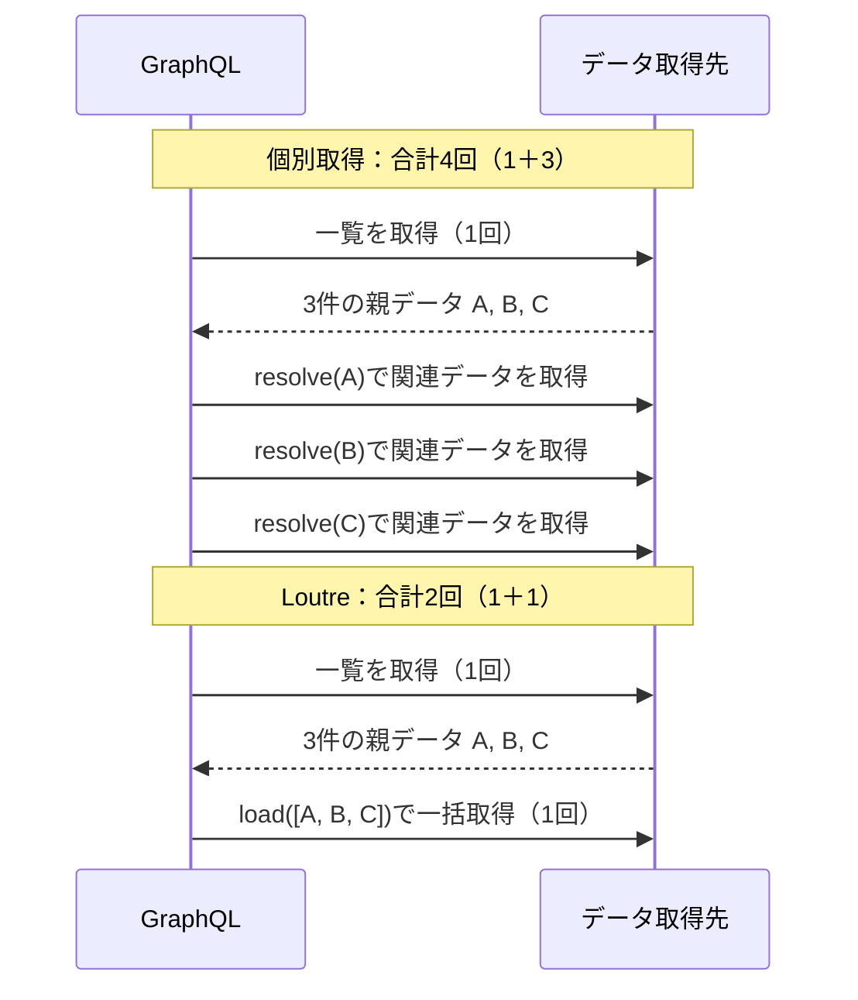

# GraphQLとCodegen

Loutreでは、GraphQLのSDLをコントラクトとして共有し、CLIでStatic Schemaや型付きResolverを生成できる。Query・MutationはHTTP、SubscriptionはWebSocketを使い、同じApplicationから公開する。

## インストール

```sh
npm install @loutrejs/loutre @loutrejs/graphql graphql
npm install --save-dev @loutrejs/cli
```

## SDLを定義する

まず`contracts/counter.graphql`などのSDLを作る。Query、Mutation、Subscriptionを同じSchemaに定義できる。

```graphql
type Counter {
  value: Int!
}

type Query {
  counter: Counter!
}

type Mutation {
  increment(amount: Int!): Counter!
}

type Subscription {
  counterChanged: Counter!
}
```

## 型とSchemaを生成する

`graphql.config.ts`から、Server向けの`types.ts`、`schema-ast.ts`、`bindings.ts`を生成する。`schema`や`output`のパスは設定ファイルからの相対パスになる。

```ts
import type { GraphQLCodegenConfig } from '@loutrejs/cli'

export default {
  targets: {
    server: {
      kind: 'server',
      schema: ['contracts/*.graphql'],
      output: 'src/graphql/generated',
    },
  },
} satisfies GraphQLCodegenConfig
```

```sh
loutre graphql generate --config graphql.config.ts
loutre graphql generate --config graphql.config.ts --check
loutre graphql generate --config graphql.config.ts --watch
```

生成ファイルは直接変更せず、SDLを修正してから再生成する。Client向けのtargetを追加すると、Operationの変数・結果型と`TypedDocumentNode`も生成できる。

## SDLから型付きResolverを実装する

生成された`Resolvers<AppContext>`に実装を合わせると、SDLの引数と戻り値の型がResolverへ伝わる。たとえば`increment(amount: Int!): Counter!`の`args.amount`は`number`となり、戻り値には`Counter`の`value`が必要になる。Resolver側で同じ型を手書きする必要はない。

```ts
import type { Resolvers } from './generated/types.js'
import type { AppContext } from './context.js'

export const resolvers = {
  Query: {
    counter: ({ context }) => context.counter.current(),
  },
  Mutation: {
    increment: ({ args, context }) => context.counter.increment(args.amount),
  },
} satisfies Resolvers<AppContext>
```

`AppContext`と`context.counter`はApplication側が定義する。SDLの変更後に再生成して型チェックすると、引数や戻り値の変更に追従していない実装を検出できる。生成された`schema-ast.ts`と`bindings.ts`も同じSDLに由来するため、その契約をそのままEndpointへ接続できる。

## EndpointとResolverを接続する

生成された`bindManifest`でSDLとResolverを関連付ける。Endpointの`factory`では、ApplicationのDIで受け取ったServiceをContextへ接続する。

```ts
import { graphql } from '@loutrejs/graphql'
import { inject } from '@loutrejs/loutre'
import { bindManifest } from './graphql/generated/bindings.js'
import { schemaDocument } from './graphql/generated/schema-ast.js'
import { resolvers } from './graphql/resolvers.js'
import { CounterStore } from './domain/counter.js'
import type { AppContext } from './graphql/context.js'

const manifest = bindManifest<AppContext>({ schemaDocument, resolvers })

export const endpoint = graphql.endpoint({
  name: 'Counter',
  path: '/graphql',
  manifest,
  transports: { http: true, websocket: true },
  factory: (counter = inject(CounterStore)) => ({
    context: ({ signal }) => ({ counter, signal }),
  }),
})
```

Resolverは生成した`Resolvers<AppContext>`型で検証できる。通常の`resolve`やSubscriptionの`subscribe`は`{ parent, args, context, info }`を受け取る。GraphQLのSchemaをEndpointに直接渡す`schema`／`typeDefs` APIではなく、Manifestを利用する。

## Query・Mutation・Subscription

QueryやMutationはHTTPで実行できる。CounterのQueryは、Server起動後に次のように呼べる。

```sh
curl http://127.0.0.1:3000/graphql \
  -H 'content-type: application/json' \
  --data '{"query":"query { counter { value } }"}'
```

SubscriptionにはWebSocket subprotocolの`graphql-transport-ws`を利用する。`subscribe`がAsyncIterableを返し、`resolve`がイベントを応答に変換する。購読解除・切断・drain時には`signal`の中断とiteratorの終了処理が伝播する。

Node.js、Bun、Cloudflare WorkersではHTTP／WebSocketの両Transportを使える。AWS LambdaではHTTPのみ対応する。

## Data ResolutionとN+1問題

一覧の関連データを1件ずつ取得すると、一覧取得の1回に加え、件数分の問い合わせが増える（N+1問題）。Loutreは同じFieldへの要求をまとめて`load`を呼び出す。



3件の一覧を1回で取得し、同じField・引数・Selectionの要求が同期的に集まる例。一括取得の処理はApplication側で実装する。

### loadの実装

注文一覧の商品を`load`でまとめて取得する例。取得要求の集約と実行Scopeの管理はLoutreが行うため、DataLoaderの組み込みやScopeの手動管理は必要ない。

```ts
const product = {
  requires: ['productId'],
  load: ({ parents: items, context, signal }) =>
    context.catalog.findForItems(items, { signal }),
}
```

`catalog`はApplication側が実装するService。`load`はParentと同じ順序・件数で結果を返す必要がある。一括取得や重複IDの扱いはServiceが担当し、Loutreが自動的にSQLへ変換するわけではない。

## データ取得パターン

関連データを先に取得してParentに含めるか、Fieldの`load`で取得するかはApplication側で決める。Loutreは取得済みの値を再利用し、不足したFieldを`load`で補うため、同じField定義で両方を扱える。

EAGER／HYBRID／LAZYは、[GraphQL Orders](https://github.com/come25136/loutrejs/tree/main/examples/graphql-orders)で比較できる取得方針の名前。サンプルではApplication側の`strategy`引数で切り替え、注文一覧に`customer`と`items.product`を含めて返す。

Queryの`resolve`では、`getFieldSelection(info)`で要求されたFieldを確認し、先読みの範囲を決められる。

| 取得方針 | Query側で先に取得する関連データ | Fieldのloadで取得する関連データ |
| -------- | ------------------------------- | ------------------------------- |
| EAGER    | customer、product               | なし                            |
| HYBRID   | customer                        | product                         |
| LAZY     | なし                            | customer、product               |

### EAGER

Queryの`resolve`で関連データまで取得し、Parentの同名プロパティに含めて返す。引数のないFieldではLoutreがその値を再利用し、`load`を呼ばない。

Ordersの例では、各注文に`customer`、各明細に`product`を持たせる。関連データを先にそろえられる場合に使える。JOINや別APIなど、先に取得する方法はApplication側で決める。

### HYBRID

先に取得できる関連データをParentに含め、残りを`load`で取得する。Ordersの例では`customer`を再利用し、`product`を`OrderItem.product.load`で補う。

同じFieldでも、取得済みのParentと未取得のParentが混在できる。3件の明細のうち1件だけが`product`を持っていれば、その1件を再利用し、残り2件を`load`へ渡す。

### LAZY

Query側では一覧と関連データの取得に必要なキーを返し、関連Fieldの取得を`load`へ任せる。Loutreが同じFieldへの要求をまとめて`load`を呼び出す。

Ordersの例では`customerId`と`productId`などをParentに持たせ、`Order.customer.load`と`OrderItem.product.load`で取得する。

## 再利用とBatchの条件

### 引数のないField

引数のないFieldは、Parentに同名のデータプロパティがあり、`undefined`でなければ再利用する。同じBatchに集まる3件のうち、`product`を先読みした件数で`load`へ渡すParentが変わる。

| 先読み済み | loadへ渡すParent | loadの呼び出し |
| ---------- | ---------------- | -------------- |
| 0件        | 3件              | 1回            |
| 1件        | 2件              | 1回            |
| 3件        | 0件              | なし           |

`null`、空配列、`false`、`0`、空文字も取得済みとして扱う。prototypeのプロパティやgetterは自動的に読み取らない。

### 引数付きField

先読み済みデータが要求された引数に合うかを`read`で判定する。`data.loaded(value)`を返すと再利用し、`data.missing`を返すと`load`へ進む。次は`posts(first: Int!)`の先読み結果を再利用する例。

```ts
import { data } from '@loutrejs/graphql'

const posts = {
  requires: ['id'],
  read: ({ parent, args }) =>
    parent.postsPage?.first === args.first
      ? data.loaded(parent.postsPage.items)
      : data.missing,
  load: ({ parents: users, args, context, signal }) =>
    context.posts.findForUsers(users, { first: args.first, signal }),
}
```

Schemaで引数を定義したFieldは、呼び出し時に引数を省略しても自動再利用しない。`authorize`は再利用や取得より先に実行される。

### Batchの単位

- QueueはQuery Operation、Mutation root Field、SubscriptionのDelivery Eventごとに分離する。
- 引数・Selectionの違い、非同期のParent、`maxBatchSize`によって複数のBatchに分かれる。
- `getFieldSelection(info)`で選択されたFieldを先読み判断に使える。

比較図と実装例は[Batch Resolutionの図解](https://loutrejs.come25136.id/ja/features/batch-resolution/)でも確認できる。

## サンプルと詳細仕様

- [GraphQL Counter](https://github.com/come25136/loutrejs/tree/main/examples/graphql-counter)：Query、Mutation、Subscription、型付きBindingの使い方。
- [GraphQL Orders](https://github.com/come25136/loutrejs/tree/main/examples/graphql-orders)：EAGER／HYBRID／LAZYのData Resolutionを比較。
- [GraphQL実装ガイド（英語）](https://github.com/come25136/loutrejs/blob/main/docs/graphql-codegen.md)：Domain Mapper、Scalar、Error Formatting、認可、Batch Scopeの詳しい仕様。
