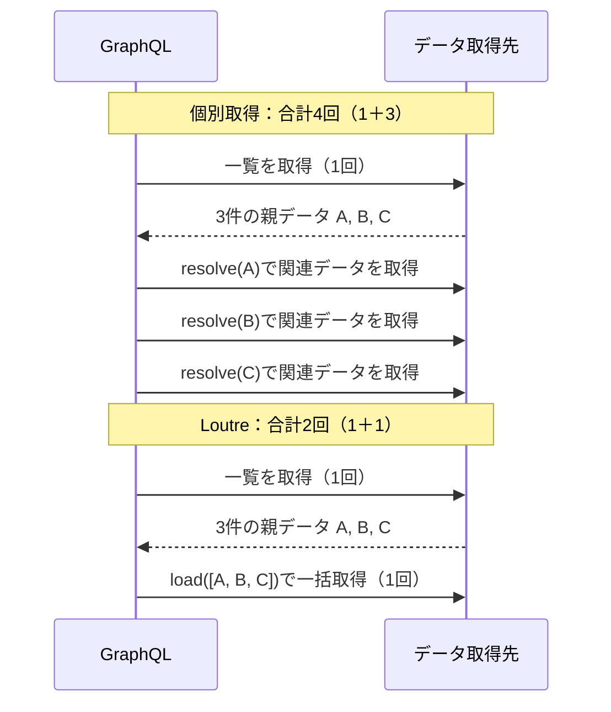

# GraphQLとCodegen

Loutreでは、GraphQLのSDLをコントラクトとして共有し、CLIでStatic Schemaや型付きResolverを生成できる。Query・MutationはHTTP、SubscriptionはWebSocketを使い、同じApplicationから公開する。

## インストール

```sh
npm install @loutrejs/loutre @loutrejs/graphql graphql
npm install --save-dev @loutrejs/cli
```

## SDLを定義する

まず`contracts/counter.graphql`などのSDLを作る。Query、Mutation、Subscriptionを同じSchemaに定義できる。

```graphql
type Counter {
  value: Int!
}

type Query {
  counter: Counter!
}

type Mutation {
  increment(amount: Int!): Counter!
}

type Subscription {
  counterChanged: Counter!
}
```

## 型とSchemaを生成する

`graphql.config.ts`から、Server向けの`types.ts`、`schema-ast.ts`、`bindings.ts`を生成する。設定は静的なオブジェクトリテラルとしてexportする。type-only importと`satisfies`を使えるが、関数呼び出し・spread・値のimportは評価しない。JSONでも同じ`targets`構造を使える。

```ts
import type { GraphQLCodegenConfig } from '@loutrejs/cli'

export default {
  targets: {
    server: {
      kind: 'server',
      schema: ['contracts/*.graphql'],
      output: 'src/graphql/generated',
    },
  },
} satisfies GraphQLCodegenConfig
```

```sh
loutre graphql generate --config graphql.config.ts
loutre graphql generate --config graphql.config.ts --target server
loutre graphql generate --config graphql.config.ts --check
loutre graphql generate --config graphql.config.ts --watch
```

`schema`、`documents`、`output`のパスは設定ファイルからの相対パスになる。Serverの出力ディレクトリは生成専用にし、手書きのソースを置かない。生成ファイルは直接変更せず、SDLを修正してから再生成する。

Client向けのtargetを追加すると、名前付きOperationとFragmentから変数・結果型と`TypedDocumentNode`を生成できる。Clientの出力先はServerの出力ディレクトリの外に置き、Client側のプロジェクトに`@graphql-typed-document-node/core`を追加する。Serverの生成だけならClient targetは不要。

```ts
client: {
  kind: 'client',
  schema: ['contracts/*.graphql'],
  documents: ['operations/**/*.graphql'],
  output: 'src/client/generated.ts',
},
```

生成ファイルには`@generated`が付く。全targetを一時出力先で生成・整形・検証してから更新し、更新に失敗した場合は全targetを直前の有効な生成結果へ戻す。`--check`は書き込まずに生成内容を比較する。WatchはSDL・Operation・設定の追加・変更・削除を追跡し、エラー時も直前の有効な生成結果を維持する。Resolver実装の変更は、Applicationの再起動またはHMRによるreload時に再接続される。

## Domain Mapper・Scalar・Enum

Server targetの`mappers`で、公開するGraphQL型とDomain型の対応を指定する。たとえばSDLでは`product: Product!`を公開し、Domainの`OrderItem`には`productId`を持たせられる。Mapperは型生成にだけ作用し、実行時のオブジェクト変換や永続化は行わない。import名が衝突した場合はaliasが付く。

```ts
mappers: {
  OrderItem: '../../domain/order.js#OrderItem',
  Product: '../../domain/product.js#Product',
},
```

Mapperのimportパスは、生成する`types.ts`からの相対パスになる。MapperはServer専用の設定。ApplicationのContextは設定に含めず、`bindManifest<AppContext>`または`Resolvers<AppContext>`で指定する。ResolverのParent・Args・ResultはSDLとDomain型から推論される。ArgsにはInput Objectのデフォルト値を含むGraphQLの型変換後の値が渡る。

Custom Scalarの入力型と出力型はtargetごとに指定する。未指定のScalarが`any`へ暗黙に変わることはない。

```json
{ "scalars": { "DateTime": { "input": "Date", "output": "Date" } } }
```

上記はServer側で`Date`を使う例。Client側の`DateTime`は通信形式に合わせて文字列にする。Serverでは`GraphQLScalarType`によるparseとserializeを`resolvers`へ登録する。同じResolver ModuleへUnion／Interfaceの`__resolveType`、Objectの`__isTypeOf`、Enumの値の対応も登録できる。生成時にDomain Moduleは実行されず、参照先のimportと型の互換性はTypeScriptが検証する。

Enumの内部値がSDLの名前と異なる場合は、Server targetの`enumValues`へ対応を指定する。たとえば`enumValues: { Role: { MEMBER: 0, ADMIN: 2 } }`と書くか、`enumValues: { Role: '../../domain/role.js#Role' }`でDomainのEnum型を参照する。対応はResolverの引数、Input Object、通常とBatchの戻り値に反映される。実行時の値の対応は別途`resolvers.Role`へ登録する。Clientは通信上のSDL名を使うため、`enumValues`を設定しない。

## SDLから型付きResolverを実装する

生成された`Resolvers<AppContext>`に実装を合わせると、SDLの引数と戻り値の型がResolverへ伝わる。たとえば`increment(amount: Int!): Counter!`の`args.amount`は`number`となり、戻り値には`Counter`の`value`が必要になる。Resolver側で同じ型を手書きする必要はない。

```ts
import type { Resolvers } from './generated/types.js'
import type { AppContext } from './context.js'

export const resolvers = {
  Query: {
    counter: ({ context }) => context.counter.current(),
  },
  Mutation: {
    increment: ({ args, context }) => context.counter.increment(args.amount),
  },
} satisfies Resolvers<AppContext>
```

`AppContext`と`context.counter`はApplication側が定義する。SDLの変更後に再生成して型チェックすると、引数や戻り値の変更に追従していない実装を検出できる。生成された`schema-ast.ts`と`bindings.ts`も同じSDLに由来するため、その契約をそのままEndpointへ接続できる。

## EndpointとResolverを接続する

生成された`bindManifest`でSDLとResolverを関連付ける。Endpointの`factory`では、ApplicationのDIで受け取ったServiceをContextへ接続する。

```ts
import { graphql } from '@loutrejs/graphql'
import { inject } from '@loutrejs/loutre'
import { bindManifest } from './graphql/generated/bindings.js'
import { schemaDocument } from './graphql/generated/schema-ast.js'
import { resolvers } from './graphql/resolvers.js'
import { CounterStore } from './domain/counter.js'
import type { AppContext } from './graphql/context.js'

const manifest = bindManifest<AppContext>({ schemaDocument, resolvers })

export const endpoint = graphql.endpoint({
  name: 'Counter',
  path: '/graphql',
  manifest,
  transports: { http: true, websocket: true },
  factory: (counter = inject(CounterStore)) => ({
    context: ({ signal }) => ({ counter, signal }),
  }),
})
```

Resolverは生成した`Resolvers<AppContext>`型で検証できる。通常の`resolve`やSubscriptionの`subscribe`は`{ parent, args, context, info }`を受け取る。GraphQLのSchemaをEndpointに直接渡す`schema`／`typeDefs` APIではなく、Manifestを利用する。

Batch対象のFieldは`{ requires, read, load, authorize, maxBatchSize }`を直接指定する。`load`と`resolve`／`subscribe`は併用できない。Subscriptionのroot Fieldには`subscribe`と`resolve`を使う。`load`は`{ parents, args, context, signal, selection }`、`__resolveType`と`__isTypeOf`は`{ parent, context, info }`を受け取る。Scalarには標準の`GraphQLScalarType`の契約を使う。

`schema-ast.ts`はSDL由来のASTだけをexportし、ContextやResolverの型には依存しない。Schema固有の`bindManifest`は生成された`bindings.ts`からimportする。`bindManifest<AppContext>`へResolverを直接書く場合もParent・Args・Result・Contextを推論でき、未知のType／Fieldや不正な戻り値を型エラーにする。共有Runtimeの`bindManifest`は低水準の関数であり、Schema固有の型付けには生成したhelperを使う。

Manifestは内部構造を公開しない型で、Endpointは`schema`、`typeDefs`、`rootValue`を直接受け付けない。`makeExecutableSchema()`や手動のSchema準備は不要。BindingはApplicationが管理するModuleに置き、生成ModuleからResolverをimportしない。Resolver側では`generated/types`のtype-only importを使い、Binding Moduleの値を逆向きにimportしない。Schemaの構築とResolverの接続はApplicationの初期化時に一度だけ行う。

## Query・Mutation・Subscription

QueryやMutationはHTTPで実行できる。CounterのQueryは、Server起動後に次のように呼べる。

```sh
curl http://127.0.0.1:3000/graphql \
  -H 'content-type: application/json' \
  --data '{"query":"query { counter { value } }"}'
```

SubscriptionにはWebSocket subprotocolの`graphql-transport-ws`を利用する。`subscribe`がAsyncIterableを返し、`resolve`がイベントを応答に変換する。購読解除・切断・drain時には`signal`の中断とiteratorの終了処理が伝播する。

Node.js、Bun、Cloudflare WorkersではHTTP／WebSocketの両Transportを使える。AWS LambdaではHTTPのみ対応する。

## 入力検証とエラー整形

SDLが保証するのは型・nullability・GraphQLの型変換まで。文字列長、配列件数、日付の業務制約などはZodやDomain側で検証する。たとえばResolverで`z.object({ first: z.number().int().min(1).max(100) }).parse(args)`を呼び、検証した値をApplication Serviceへ渡せる。

Endpointの`factory`から任意の`formatError(error, input)`を返すと、HTTPとWebSocketで共通の公開エラーとログ方針を設定できる。`error`は`GraphQLError`で、Resolver・`load`・`subscribe`が投げた例外は`originalError`から取得する。`input`にはContext生成時と同様にTransportごとのrequestとsignalが入り、WebSocketでは`operationId`と`connectionParams`、HTTPでは`state`も使える。

```ts
import { ZodError } from 'zod'

factory: () => ({
  context: ({ signal }) => ({ signal }),
  formatError(error, input) {
    if (error.originalError instanceof ZodError) {
      return {
        message: '入力が不正です。',
        extensions: {
          code: 'BAD_USER_INPUT',
          details: error.originalError.issues,
        },
      }
    }
    if (!error.originalError) return error.toJSON()
    console.error(`[GraphQL ${input.transport}]`, error.originalError)
    return { message: '内部エラーが発生しました。' }
  },
})
```

`formatError`は`GraphQLFormattedError`を同期的に返す。parse・検証・変数の型変換・Field実行・Subscription開始・各Delivery Eventで発生するGraphQLエラーを扱う。`path`と`locations`を省略すると元の値を維持し、`extensions`は戻り値に含めたものだけを公開する。`data`、HTTP status、WebSocketのframe種別、non-nullのエラー伝播は変更しない。hookを省略すると標準のGraphQLエラーを返す。

Subscriptionのiterator失敗はRuntimeの可観測性にも記録され、WebSocketのerror frameを整形してOperationを終了する。Context生成中や`formatError`自体の例外は通常のRuntime失敗として扱う。HTTP middlewareの認証応答とWebSocketのprotocol違反は、それぞれのTransportが処理する。

HTTPの`application/graphql-response+json`では、実行前に発生して`data`を持たないGraphQLエラーは400、Resolver実行中のGraphQLエラーは200を返す。`application/json`では、GraphQL requestのエラーも200を維持する。

## Data ResolutionとN+1問題

一覧の関連データを1件ずつ取得すると、一覧取得の1回に加え、件数分の問い合わせが増える（N+1問題）。Loutreは同じFieldへの要求をまとめて`load`を呼び出す。



3件の一覧を1回で取得し、同じField・引数・Selectionの要求が同期的に集まる例。一括取得の処理はApplication側で実装する。

### loadの実装

注文一覧の商品を`load`でまとめて取得する例。取得要求の集約と実行Scopeの管理はLoutreが行うため、DataLoaderの組み込みやScopeの手動管理は必要ない。

```ts
const product = {
  requires: ['productId'],
  load: ({ parents: items, context, signal }) =>
    context.catalog.findForItems(items, { signal }),
}
```

`catalog`はApplication側が実装するService。`load`はParentと同じ順序・件数で結果を返す必要がある。一括取得や重複IDの扱いはServiceが担当し、Loutreが自動的にSQLへ変換するわけではない。

## データ取得パターン

関連データを先に取得してParentに含めるか、Fieldの`load`で取得するかはApplication側で決める。Loutreは取得済みの値を再利用し、不足したFieldを`load`で補うため、同じField定義で両方を扱える。

EAGER／HYBRID／LAZYは、[GraphQL Orders](https://github.com/come25136/loutrejs/tree/main/examples/graphql-orders)で比較できる取得方針の名前。サンプルではApplication側の`strategy`引数で切り替え、注文一覧に`customer`と`items.product`を含めて返す。

Queryの`resolve`では、`getFieldSelection(info)`で要求されたFieldを確認し、先読みの範囲を決められる。

| 取得方針 | Query側で先に取得する関連データ | Fieldのloadで取得する関連データ |
| -------- | ------------------------------- | ------------------------------- |
| EAGER    | customer、product               | なし                            |
| HYBRID   | customer                        | product                         |
| LAZY     | なし                            | customer、product               |

### EAGER

Queryの`resolve`で関連データまで取得し、Parentの同名プロパティに含めて返す。引数のないFieldではLoutreがその値を再利用し、`load`を呼ばない。

Ordersの例では、各注文に`customer`、各明細に`product`を持たせる。関連データを先にそろえられる場合に使える。JOINや別APIなど、先に取得する方法はApplication側で決める。

### HYBRID

先に取得できる関連データをParentに含め、残りを`load`で取得する。Ordersの例では`customer`を再利用し、`product`を`OrderItem.product.load`で補う。

同じFieldでも、取得済みのParentと未取得のParentが混在できる。3件の明細のうち1件だけが`product`を持っていれば、その1件を再利用し、残り2件を`load`へ渡す。

### LAZY

Query側では一覧と関連データの取得に必要なキーを返し、関連Fieldの取得を`load`へ任せる。Loutreが同じFieldへの要求をまとめて`load`を呼び出す。

Ordersの例では`customerId`と`productId`などをParentに持たせ、`Order.customer.load`と`OrderItem.product.load`で取得する。

## 再利用とBatchの条件

### 引数のないField

引数のないFieldは、Parentに同名のデータプロパティがあり、`undefined`でなければ再利用する。同じBatchに集まる3件のうち、`product`を先読みした件数で`load`へ渡すParentが変わる。

| 先読み済み | loadへ渡すParent | loadの呼び出し |
| ---------- | ---------------- | -------------- |
| 0件        | 3件              | 1回            |
| 1件        | 2件              | 1回            |
| 3件        | 0件              | なし           |

`null`、空配列、`false`、`0`、空文字も取得済みとして扱う。prototypeのプロパティやgetterは自動的に読み取らない。

### 引数付きField

先読み済みデータが要求された引数に合うかを`read`で判定する。`data.loaded(value)`を返すと再利用し、`data.missing`を返すと`load`へ進む。次は`posts(first: Int!)`の先読み結果を再利用する例。

```ts
import { data } from '@loutrejs/graphql'

const posts = {
  requires: ['id'],
  read: ({ parent, args }) =>
    parent.postsPage?.first === args.first
      ? data.loaded(parent.postsPage.items)
      : data.missing,
  load: ({ parents: users, args, context, signal }) =>
    context.posts.findForUsers(users, { first: args.first, signal }),
  maxBatchSize: 100,
}
```

Schemaで引数を定義したFieldは、呼び出し時に引数を省略しても自動再利用しない。`authorize`は再利用や取得より先に実行される。

`data.loaded(undefined)`は使えない。`requires`の検証は未取得のデータにだけ行い、`load`へは元の順序でParentを渡す。必要な内部キーの欠落や、Parentと戻り値の件数の不一致はGraphQLのFieldエラーになる。

`load`の戻り値にはParentごとの`Error`を含められる。その要素だけがGraphQLのFieldエラーとなり、pathとnullabilityに従って応答へ反映される。`load`自体がthrowした場合はBatch全体のFieldが失敗する。

### Batchの単位

- QueueはQuery Operation、Mutation root Field、SubscriptionのDelivery Eventごとに分離する。
- 引数・Selectionの違い、非同期のParent、`maxBatchSize`によって複数のBatchに分かれる。
- `getFieldSelection(info)`で選択されたFieldを先読み判断に使える。

Batchは実行Scope・Field定義・型変換後の引数でまとめる。alias、オブジェクトのキー順、デフォルト値を明示したかどうかでは分割しない。`Date`やclass instanceなど等価性が不確かな引数は分離する。Selectionが異なる要求も分け、`load`に`selection`を渡す。同期的に集まった要求はmicrotaskの境界で実行し、`maxBatchSize`ごとに分割する。

同じParentオブジェクトへの同一要求は、実行中の処理を共有できる。完了した値や同じIDだけを根拠にしたentity cacheはない。RepositoryではParentごとのTenant・認可・Revisionの情報を維持し、必要に応じて複合キーで重複をまとめる。

比較図と実装例は[Batch Resolutionの図解](https://loutrejs.come25136.id/ja/features/batch-resolution/)でも確認できる。

## 認可と実行Scope

Batch Fieldの`authorize`は`read`・値の再利用・`load`より先に実行される。`resolve`が先読みしたデータを返す場合も、Repositoryで認可を適用する。

ScopeはHTTP／WebSocketのQuery Operationごと、Mutationのroot Fieldごと、SubscriptionのDelivery Eventごとに作られる。別のHTTP request間や、同じWebSocket接続上の並行Operation間でBatchを共有しない。Scopeの手動作成や`AsyncLocalStorage`の導入は不要。

HTTPのabort、WebSocketのcomplete・切断・drainは、`signal`を通じて`context`と`load`へ伝播する。外部I/Oもこのsignalを使って協調的に中断する。GraphQLのエラーpath、non-null／Listの扱い、introspectionはGraphQL.jsに従う。

## Field Selectionと可観測性

Resolverの`info`を`getFieldSelection(info)`へ渡すと、選択されたFieldのツリーを取得できる。各nodeは`parentType`、`fieldName`、`responseKeys`、`args`、`children`、`requires`、`prefetchable`を持つ。alias、Fragment、Inline Fragment、`skip`／`include`、変数、デフォルト引数、Interface／Unionの具体型を考慮し、内部依存のために`__typename`を要求しない。`defer`と`stream`は明示的に拒否する。

この情報を先読みの判断に使えるが、SQL、pagination、`totalCount`、transaction、snapshotはRepository側で決める。部分的なDomain値をLoutreが自動補完することはないため、子Resolverで不足するFieldを補えない場合は完全なDomainオブジェクトを返す。

Operation traceには`graphql.data.field.reused_count`、`graphql.data.batch.call_count`、`graphql.data.batch.parent_count`、`graphql.data.batch.duration_ms`が集計される。BatchやSQLの実行回数が常に1回になる保証はない。

## SDLの共有とCI

contracts用workspaceやversion付きSDL packageで契約を共有し、lockfileでversionを固定する。利用側はServerの実装完了を待たずにOperationを書き、Client型を生成できる。

```sh
loutre graphql validate --schema 'contracts/**/*.graphql'
loutre graphql diff --before released/schema.graphql --after contracts/schema.graphql --json
```

`diff`は破壊的変更で終了コード1を返し、Enum値の追加など注意が必要な変更は別途報告する。Schemaの差分だけでは認可やServiceの動作までは保証できない。SDLのファイル分割と`extend`には対応し、Federationとstitchingには対応しない。

生成ファイルはcommitし、CIで`--check`、TypeScriptの型チェック、integration testを実行する。

## サンプルと詳細仕様

- [GraphQL Counter](https://github.com/come25136/loutrejs/tree/main/examples/graphql-counter)：Query、Mutation、Subscription、型付きBindingの使い方。
- [GraphQL Orders](https://github.com/come25136/loutrejs/tree/main/examples/graphql-orders)：EAGER／HYBRID／LAZYのData Resolutionを比較。
- [GraphQL設計ADR（日本語）](../adr/loutre_graphql_codegen_architecture.md)：Codegen、Manifest、Data Resolutionの設計判断と責務分担。
