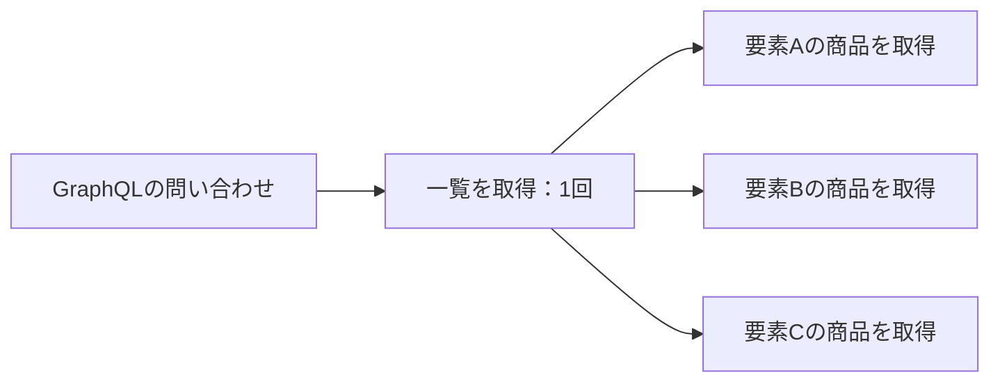

# GraphQLのN+1問題をTypeScriptで確認する

GraphQLで一覧と関連データを取得すると、resolverの書き方によっては一覧の件数分だけ追加の問い合わせが発生します。LoutreのOrdersサンプルを動かし、先読みとBatch Resolutionで取得の仕方がどう変わるかを確認します。

## N+1問題が起きる場面

たとえば注文一覧を1回取得し、各注文の商品をresolverから1件ずつ取得すると、一覧の取得に加えて商品の問い合わせが増えます。最初の1回と、一覧の要素数N回を合わせてN+1と呼びます。HTTPリクエストが1回でも、サーバー内部のデータ取得は複数回になる点がポイントです。



これはGraphQLを使うだけで必ず発生する問題ではありません。関連データをまとめて取得する、一覧と一緒に先読みするなど、データ取得の境界を変えることで減らせます。

## 一括取得と先読みを使い分ける

DataLoaderは個別の取得要求をまとめるためによく使われます。Loutreでは関連フィールドの`load`を定義し、実行スコープ内で要求をまとめるBatch Resolutionを利用できます。一括取得するサービスの処理はアプリケーションで実装します。

一方、返す関連データが分かっているときは先読みも選択肢です。Ordersサンプルでは同じGraphQLの結果を、次の3つの取得方法で返します。

| 取得方法 | サンプルの動作                                             |
| -------- | ---------------------------------------------------------- |
| `EAGER`  | 顧客と商品を先読みする                                     |
| `HYBRID` | 顧客を先読みし、商品はフィールドの`load`で取得する         |
| `LAZY`   | 関連するドメインオブジェクトをフィールドの`load`で取得する |

どの方法が適するかは、必要なフィールド、データ取得元、先読みのコストによって変わります。呼び出し回数だけでなく、不要なデータを読み込んでいないかも確認します。

## Ordersサンプルを動かす

Node.js 22以降を用意し、リポジトリのルートで実行します。

```sh
git clone https://github.com/come25136/loutrejs.git
cd loutrejs
npm ci
npm run build
npm run generate --workspace @loutrejs/example-graphql-orders
npm run dev --workspace @loutrejs/example-graphql-orders
```

サーバーは`http://127.0.0.1:3000/graphql`で起動します。以降のコマンドは別のターミナルから実行してください。このサンプルはメモリ内のデータを使うため、データベースの準備は不要です。

## 商品の一括取得回数を比較する

最初に商品の一括取得の累計回数を確認します。

```sh
curl http://127.0.0.1:3000/graphql \
  -H 'content-type: application/json' \
  --data '{"query":"{ productBatchCount }"}'
```

次に、`LAZY`で100件の注文と関連する商品を取得します。

```sh
curl http://127.0.0.1:3000/graphql \
  -H 'content-type: application/json' \
  --data '{"query":"query($strategy:Strategy!){ orders(strategy:$strategy,pagination:{offset:0,limit:100}){ totalCount edges{id items{quantity product{name}}}}}","variables":{"strategy":"LAZY"}}'
```

もう一度`productBatchCount`を問い合わせ、実行前との差分を確認します。続けて`strategy`を`EAGER`、`HYBRID`に変え、それぞれの実行前後で比較してください。累計値同士を比較すると前の問い合わせの分が混ざるため、毎回差分を取ります。

`EAGER`では商品を先読みするため、フィールド解決による追加のloadは不要です。`LAZY`と`HYBRID`では商品の取得要求がloadへ集約されます。ただし、非同期処理の完了タイミングや選択したフィールドによってバッチは分かれるため、「100件でも必ず1回」とは限りません。

`productBatchCount`が表すのは、このサンプルの商品の一括取得関数の呼び出し回数です。SQLの実行回数、GraphQL全体の問い合わせ回数、応答速度を表す値ではありません。

## アプリケーションへ適用する

まず[Batch Resolutionの図とコード比較](https://loutrejs.come25136.id/ja/features/batch-resolution/)で、個別resolverを`load`へ置き換える箇所を確認します。APIの契約、実行スコープ、認可、先読みデータの再利用は[GraphQLとCodegen](./graphql-codegen.md)を参照してください。

[Ordersサンプルのresolver](https://github.com/come25136/loutrejs/blob/main/examples/graphql-orders/src/graphql/resolvers.ts)には、TenantやRevisionを含めて商品を取得し、親の順序に対応させる実装があります。自分のデータソースへ適用するときも、異なる利用者や版のデータを同じ取得キーとして扱わないことが必要です。

## 参考資料

- [GraphQL.js：DataLoaderによるN+1問題への対処](https://www.graphql-js.org/docs/n1-dataloader/)
- [DataLoaderの公式README](https://github.com/graphql/dataloader)
